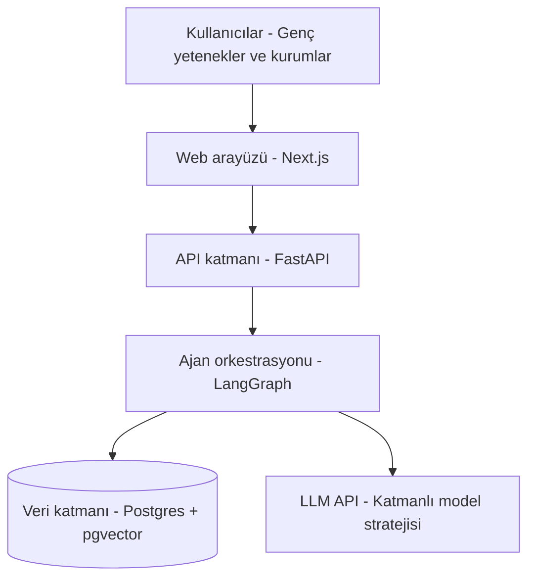

# Mimari

## Genel Bakış

Sistem, ortak bir veri katmanı üzerinde çalışan altı uzman ajandan oluşuyor. Hiçbir ajan diğerinin işini bloklamıyor — Keşif/Tanımlama akışları kullanıcı etkileşimine bağlı senkron çalışırken, Eşleştirme ve Canlılık ajanları arka plan işleri (background jobs) olarak tasarlanıyor.



## Teknoloji Kararları

| Katman | Seçim | Gerekçe |
|---|---|---|
| Ajan orkestrasyonu | **LangGraph** | Durum kalıcılığı (checkpointing) ve insan-onay noktalarını (interrupt) native destekliyor — Keşif, Doğrulama ve Eşleştirme ajanlarının hepsinde bir onay/itiraz durağı var. CrewAI/AutoGen'e göre bu ihtiyaca en uygun olanı. |
| Backend | **FastAPI (Python)** | Orkestrasyon katmanıyla aynı dilde, async destekli; bu sınıf ürünlerde sektörün en yaygın kombinasyonu. |
| Veritabanı | **PostgreSQL + pgvector** | Ayrı bir vektör veritabanı (Qdrant/Pinecone) bu veri hacminde (yüzlerce–birkaç bin kayıt) gereksiz altyapı yükü. Tek veritabanında hem ilişkisel veri hem embedding tutuluyor. |
| Frontend | **Next.js + Tailwind + shadcn/ui** | Güncel, hızlı ve profesyonel görünümlü bir arayüz için sektör standardı — UI/UX değerlendirme kriterini doğrudan destekliyor. |
| Embedding | **Voyage AI (voyage-4, 1024 boyut)** | Anthropic'in Claude ile kullanım için resmi önerdiği sağlayıcı — ilk 200M token ücretsiz, ön ödeme istemiyor (hackathon için pratikte sıfır maliyet). |
| LLM | **Gemini, ücretli katman, iki model katmanı** | Sağlayıcı Faz 1'den beri Gemini: Anthropic ön ödeme istiyordu, Gemini istemiyordu. Faz A'da ücretsiz katmandan ücretli anahtara geçildi (günde 20 istek demo için yetmiyordu); sağlayıcı değişmedi. **Katmanlar** (`app/core/llm.py`): *hızlı* — Keşif ve Tanımlama'nın yapılandırılmış çıkarımı (varsayılan `gemini-3.6-flash`, yedek `gemini-3.1-flash-lite`); *güçlü* — eşleştirme gerekçesi ve doğrulama rubriği (varsayılan `gemini-3.8-flash`, yedek `gemini-3.6-flash`). Model adları `.env`'den okunur (`GEMINI_HIZLI_MODEL`, `GEMINI_GUCLU_MODEL` ve yedekleri), kod değişmeden değişir. Güçlü katmanın varsayılanı bilerek kararlı (preview olmayan) bir model: demo 9-11 Ekim'de, preview modellerin hız sınırı ve kararlılığı belirsiz. Yeni anahtarlara kararlı bir Pro açık değil: `gemini-2.5-pro` model listesinde görünüyor ama çağrıda 404 dönüyor, `gemini-pro-latest` ise `gemini-3.1-pro-preview`'a gidiyor. Bu yüzden şimdilik en yeni kararlı Flash; Pro'ya gerek olup olmadığı aynı girdiyle Pro/Flash karşılaştırılarak kararlaştırılacak. **Yedek model** LangChain `with_fallbacks` ile aynı prompt ve şemayı ikinci modele gönderir. Amacı sağlayıcı arızası: 5xx (`GoogleAPIError`), zaman aşımı (`httpx.TimeoutException`, `GEMINI_ZAMAN_ASIMI_SN`, varsayılan 30 sn) ve anlık hız sınırı (429, `GoogleRateLimitError` — ücretli katmanda dakikalık sınır; ücretsiz katmanda günlük kotaydı) ve kullanılamayan model (404, `GoogleModelNotFoundError` — log'a `MODEL KULLANILAMIYOR` hatası ve düzeltilecek `.env` değişkeni yazılır). Hepsi model başına oluşuyor, yedek model o an genellikle çalışır. **Diğer 4xx listede yok:** hatalı istek (400) ya da yetki (401/403) ikinci modelde de aynı şekilde başarısız olur. Açılışta `.env`'deki dört model adı sağlayıcının model listesiyle karşılaştırılır; bulunamayan uyarılır, uygulama durmaz, kontrol başarısızsa sessizce geçilir. İki model de yanıt veremezse istek 503 (arıza, zaman aşımı) ya da 429 (hız sınırı) olarak döner — ayrıntı `app/core/hatalar.py`. SDK'nın kendi tekrar sayısı 6'dan **2'ye** indirildi (`MAKS_TEKRAR`): asıl tekrar stratejisi yedek model, aynı modeli üstel beklemeyle tekrar tekrar denemek dakikalar kaybettiriyordu. **Gözlemlenebilirlik:** her çağrı sunucu günlüğüne tek satır yazar: iş adı, model, süre, deneme sırası ve token kullanımı (girdi, çıktı, düşünme, toplam). |

## LLM Maliyet/Performans Stratejisi

Görevler üç kategoriye ayrılıyor, her biri farklı model gerektiriyor:

| Kategori | İşler | Katman | Varsayılan model (yedek) |
|---|---|---|---|
| **Yapılandırma/çıkarma** | Keşif ve Tanımlama sohbetlerinin alan çıkarımı | hızlı | `gemini-3.6-flash` (`gemini-3.1-flash-lite`) |
| **Gerekçeli akıl yürütme** | Eşleştirme'nin "neden eşleşti" gerekçesi, Doğrulama'nın rubrik puanlaması | güçlü | `gemini-3.8-flash` (`gemini-3.6-flash`) |
| **Embedding** | Kart temsil metni → vektör | — | Voyage `voyage-4` (LLM'den bağımsız, ayrı ve ucuz çağrı) |

Çıkarımda format zaten net, ince akıl yürütme gerekmiyor; sohbetin her turunda çağrıldığı için hız ve maliyet belirleyici. Gerekçe ve rubrik tek seferlik ama nüans önemli: kartlardaki somut noktalara atıf, kurallara uyum (itiraz notu beyandır, sayı uydurma yok). Bu katmanlama maliyetin büyük kısmını ucuz modelde tutarken kalite gereken yerde güçlü modeli devreye sokuyor. Güçlü modelin gerçekten gerekli olup olmadığı, aynı girdiyle Pro ve Flash karşılaştırılarak ölçülüyor; model `.env`'den değiştirilebildiği için karar kod değişikliği gerektirmiyor.

## Repo Yapısı

```
/docs               — bu klasör: mimari, şema, API sözleşmeleri, yol haritası
/backend            — FastAPI + LangGraph (Faz 1'de dolacak)
/frontend           — Next.js (Faz 1'de dolacak)
```

Monorepo tercih edildi — solo geliştirici + 3 haftalık sprint için ayrı repolar arası senkronizasyon yükü gereksiz.
