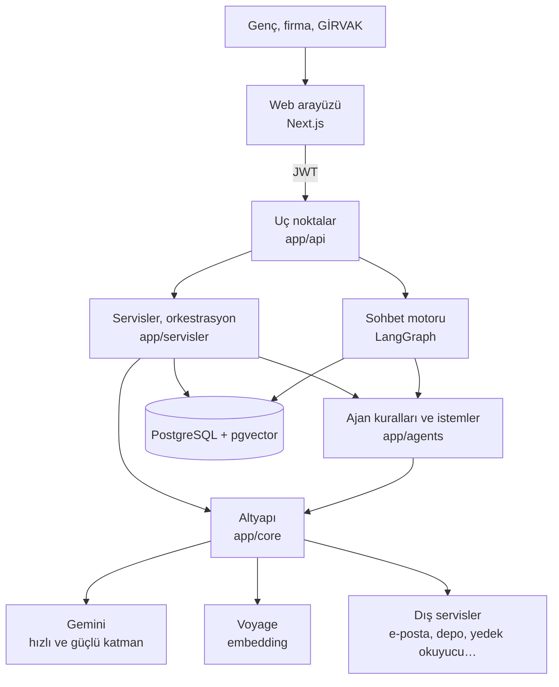

# Mimari

## Genel Bakış

Altı uzman ajan tek bir paylaşılan veri katmanı üzerinde çalışır. İki tür ajan var:

- **Sohbet ajanları** (Keşif, Tanımlama ve firma kartı sohbeti) kullanıcıyla çok turlu konuşur.
  Tek bir LangGraph motorunu paylaşırlar; sohbet Postgres checkpointer'da durur.
- **Tek seferlik hesaplar** (Eşleştirme, Doğrulama, Takip, Canlılık) bir olayla tetiklenir: kart
  onayı, kanıt eklenmesi, karşılıklı ilgi, tarama ucu. Ağır işler yanıt döndükten sonra arka planda
  (`BackgroundTasks`) çalışır.

İlke: **benzerlik aday bulur, yapay zekâ doğrular, puanı kod verir.** Dil modeli öneri, gerekçe ve
metin üretir; listeye girme, puan, durum geçişi ve tamamlanma saf kurallardadır. Hiçbir taslak
kullanıcı onaylamadan kaydedilmez.



## Teknoloji Kararları

| Katman | Seçim | Gerekçe |
|---|---|---|
| Ajan orkestrasyonu | **LangGraph** (yalnızca sohbetler) | Durum kalıcılığını (checkpointing) yerleşik destekliyor: LLM hatasında sohbet kaldığı yerden sürer. Sohbet ajanları bir `StateGraph` olarak derlenir ve aynı motoru paylaşır (`app/agents/sohbet_motoru.py`); yeni sohbet ajanı bir `AjanTanimi` yazmaktır. Tek seferlik hesaplar grafik kullanmaz; aralarındaki akışı `app/servisler/` yürütür. Supervisor ajanı ve `interrupt` kullanılmaz: insan onayı uç noktalarla sağlanır. |
| Backend | **FastAPI (Python)** | Orkestrasyonla aynı dil, async, otomatik OpenAPI belgesi (`/docs`). |
| Veritabanı | **PostgreSQL + pgvector** | Bu veri hacminde (yüzlerce–birkaç bin kart) ayrı bir vektör veritabanı gereksiz altyapı yükü. İlişkisel veri ve embedding tek yerde, tek işlemde. |
| Frontend | **Next.js (App Router) + Tailwind + shadcn/ui** | Erişilebilir hazır bileşenler; tema `design-language.md`'deki CSS değişkenlerinden. |
| Embedding | **Voyage AI** (`voyage-4`, 1024 boyut) | Kart temsil metni → vektör; LLM'den bağımsız, ucuz çağrı. Voyage'a ulaşılamazsa kart yine kaydedilir, embedding sonradan tamamlanır (`app/servisler/embedding.py`). |
| Kimlik | **E-posta + şifre, JWT (HS256, 7 gün), Bearer** | Karmaşıklık bilinçli düşük: refresh token, OAuth ile giriş ve httpOnly cookie yok (ürünleşme dönemi). Şifre argon2id. Kimlik `hesap` tablosunda, profil `kullanici` / `kurum`'da; sahiplik kuralları tek modülde (`app/servisler/sahiplik.py`); başkasının kaynağı 404. Ayrıntı: `kimlik-ve-dongu.md`. |
| Dış servisler | **Arayüz + `.env` bayrağı + zarif düşüş** | Her dış servis (`app/core/dis_servisler/`) küçük bir `Protocol` arayüzünün arkasında; somut sınıf tek kurulum noktasında (`kurulum.py`) bayrağa göre seçilir, testler sahte verir. Hata akışı düşürmez: ilgili sinyal "—" olur. Çağrılar `zaman_asimli` ve `gozlemli` sarmalayıcılarından geçer; durumları GİRVAK'ın gözlem panelinde (`GET /saglik/servisler`). Varsayılanların hepsi yerelde çalışır (`dogrulama.md` § 14.4). |
| E-posta | **Brevo ya da Resend** (`EPOSTA_SAGLAYICI`, varsayılan `log`) | Kayıt doğrulaması, referans istekleri ve karşılıklı ilgi kesinleşince "eşleştiniz" e-postası (`app/servisler/eslesme_epostasi.py`). Brevo tek doğrulanmış gönderen adresi ister, Resend doğrulanmış alan adı. `log` kipinde bağlantılar sunucu günlüğüne yazılır. `.example` gibi sahte adreslere ağ isteği atılmaz. Diğer bildirimler uygulama içinde kalır. Eşleşen iki taraf birbirine kendi adresinden yazar: "E-posta yaz" taslaklı bir `mailto:` bağlantısıdır (`frontend/src/lib/eposta-taslagi.ts`). |
| Yedek okuyucu | **Playwright, ayrı süreç** (`backend/yedek_okuyucu/`) | Düz HTTP ile okunamayan kanıt sayfasını (bot engeli, JavaScript ile çizilen sayfa, görsel portfolyo) gerçek tarayıcıda açar. Chromium ağır ve kullanıcının adresini açtığı için backend'den ayrı süreçte. SSRF: tarayıcının tek ağ kapısı süreç içi bir vekil; her bağlantı backend'in `guvenli_istek.hedefi_dogrula` kuralıyla denetlenir. Servis kapalıysa okuma onsuz biter. |
| LLM | **Gemini, iki model katmanı, yedek zincir** | Aşağıda. |

### LLM katmanları

| Katman | İşler | Varsayılan model (yedek) |
|---|---|---|
| **Hızlı** | Sohbetlerin alan çıkarımı; dosya ve görsel okuma; Canlılık hatırlatma metni; Takip durum özeti | `gemini-3.6-flash` (`gemini-3.1-flash-lite`), düşünme seviyesi `minimal` |
| **Güçlü** | Eşleştirme gerekçesi ve uygunluk kararı; Doğrulama'nın kanıt çıkarımı; Takip plan kişiselleştirmesi | `gemini-3.8-flash` (`gemini-3.6-flash`) |
| Embedding | Kart temsil metni → vektör; uzun kanıt metninde parça seçimi | Voyage `voyage-4` |

- **Neden iki katman:** çıkarım her sohbet turunda çağrılır; hız ve maliyet belirleyici, format
  zaten net. Gerekçe, rubrik ve plan tek seferlik ama nüans önemli. Hızlı katmanda düşünme
  `minimal`: varsayılan düşünmede tur ~6 sn sürüyor ve model kullanıcının söylemediği bilgiyi
  taslağa ekliyordu; `minimal`'de ~2 sn, uydurma yok.
- **Model adları `.env`'den** (`GEMINI_HIZLI_MODEL`, `GEMINI_GUCLU_MODEL` ve yedekleri); kod
  değişmeden değişir. Güçlü katmanın varsayılanı bilerek kararlı (preview olmayan) bir model.
  Pro'ya geçmenin gerekli olup olmadığı aynı girdiyle karşılaştırılarak kararlaştırılacak.
- **Yedek model** (LangChain `with_fallbacks`) aynı istemi ve şemayı ikinci modele gönderir.
  Tetikleyen hatalar: 5xx, zaman aşımı (`GEMINI_ZAMAN_ASIMI_SN`, varsayılan 30 sn), anlık hız
  sınırı (429) ve kullanılamayan model (404; günlüğe düzeltilecek `.env` değişkeni yazılır).
  Diğer 4xx (hatalı istek, yetki) ikinci modelde de aynı şekilde başarısız olacağı için listede
  yok. SDK'nın kendi tekrar sayısı 2'ye indirildi: asıl tekrar stratejisi yedek model.
- **İkisi de yanıt veremezse** uç 503 (arıza, zaman aşımı) ya da 429 (hız sınırı) döner;
  `app/core/hatalar.py` her hatayı CORS başlığı ve `{"detail": ...}` gövdesiyle döndürür, böylece
  arayüz kullanıcıya doğru cümleyi gösterir.
- **Açılışta** `.env`'deki dört model adı sağlayıcının listesiyle karşılaştırılır; bulunamayan
  uyarılır, uygulama durmaz.
- **Gözlemlenebilirlik:** her çağrı günlüğe tek satır yazar: iş adı, model, süre, deneme sırası,
  token kullanımı (girdi, çıktı, düşünme).
- **İstem güvenliği:** kullanıcı metni istemde veri etiketleri içindedir (`app/core/istem_guvenligi.py`),
  kullanıcıya giden her LLM metni ortak dil kuralına uyar (`app/core/kullanici_dili.py`).

## Katmanlar (backend)

| Katman | Ne durur | Kural |
|---|---|---|
| `app/api/` | Uç noktalar: istek ve yanıt şeması, kimlik (401 / 403), "göremez" kararını 404'e çevirme, servisi çağırma | İnce kalır; aynı iş iki uçta yazılmaz |
| `app/servisler/` | Birden fazla ucun ve arka plan işinin paylaştığı orkestrasyon: eşleştirme pipeline'ı, kart hazırlama (embedding → değerlendirme → yeniden eşleştirme), ilgi akışının yan etkileri, doğrulama, sahiplik kuralları, bildirim yazma, embedding | API katmanından import etmez |
| `app/agents/` | Saf kurallar (durum makineleri, skor, eşikler, puan tavanları, süreç şablonları) ve dil modeli çağrıları (istem, şema, çıkarım) | Veritabanına yazmaz; tablolar testle sabit. Yapay zekâ öneri ve metin üretir, karar kuraldadır |
| `app/core/` | Altyapı ve küçük alan kuralları: ayarlar, LLM ve embedding istemcileri, güvenli HTTP isteği, kanıt okuma zinciri, dosya yükleme hattı, dış servis adaptörleri, şehir / müsaitlik / çalışma modeli normalizasyonu | Üst katmanlardan import etmez |
| `app/models/`, `app/schemas/`, `app/db/` | SQLAlchemy modelleri (tablo başına bir dosya), Pydantic şemaları, oturum | — |

**Arka plan işleri** `BackgroundTasks` ile yanıttan sonra çalışır, kendi oturumunu açar, hatayı
yutar ve idempotenttir (danışma kilidi, `ON CONFLICT`, versiyon kontrolü, satır kilidi). Testler
hepsini `tests/conftest.py`'de sahteyle değiştirir; testler gerçek Gemini ya da Voyage çağırmaz.

**Zamanlayıcı yok, bilinçli:** zaman aşımı ve gecikme okuma anında hesaplanır; periyodik iş bir uç
noktadır (`POST /canlilik/tarama`, `canlilik.md` § 4).

**Bilinen borç** (hackathon sonrası):
- `app/api/canlilik.py` taramanın orkestrasyonunu, `app/api/takip.py` plan ve bildirim yardımcılarını
  taşıyor; ikisi `app/servisler/`'e alınmalı.
- `app/agents/eslestirme.py` aday sorgularını (SQL okuma) da içeriyor; genç ve firma adayı için
  ikiz fonksiyonlar (gerekçe, uygunluk) tek bir aday türü stratejisinde birleşmeli.
- Eşleşme tablosundaki `genc_*` kolonları "aday tarafı" anlamında kullanılıyor (`kararlar.md` F12);
  yeniden adlandırma bir migration işi.

## Kullanılan desenler

| Desen | Nerede |
|---|---|
| Strategy | Sohbet ajanı tanımları (`AjanTanimi`), kanıt okuyucuları, OAuth sağlayıcıları, profil kodu platformları, çapa doğrulayıcıları, Takip süreç şablonları (`SurecSablonu`) |
| Chain of Responsibility | Kanıt okuma zinciri: platform okuyucusu → genel → yedek okuyucu → Jina |
| Adapter + Factory | Dış servisler (`Protocol` arayüzü, tek kurulum noktası `kurulum.py`) |
| Null Object | Bayrağı kapalı servis (`Kapali…` sınıfları): `if servis_var` dalları koda dağılmaz |
| Decorator | `zaman_asimli`, `gozlemli` sarmalayıcıları |
| State Machine | `eslesme_durumu`, `takip_durumu`, `inceleme_durumu`, `referans_durumu` (saf, tablo testli) |
| Single dispatch | Kart türüne göre embedding temsil metni (`app/servisler/embedding.py`) |
| Pipeline | Dosya yükleme hattı (tür → boyut → virüs → temizlik → okuma) |
| Value Object | `KanitBelgesi`, `BaslikPuanlari`, `Aday` (dondurulmuş dataclass) |

SOLID karşılıkları Doğrulama örneğinde ayrıntılı: `dogrulama.md` § 14.2.

## İlgi akışı (iki kapı)

Eşleşme durumu tek alanda (`eslesme.durum`), geçiş kuralı tek fonksiyonda
(`app/agents/eslesme_durumu.py` › `gecis`):

```
onerildi ──firma "ilgileniyorum"──▶ ilgileniliyor ──aday kabul──▶ kabul_edildi
   │                                              └──aday red────▶ reddedildi
   └──aday ilgi (iletişim onayıyla)──▶ genc_ilgilendi ──firma "ilgileniyorum"──▶ kabul_edildi (karşılıklı ilgi)
                                         ├──firma "şimdilik değil"──▶ kapandi
                                         └──aday geri çeker──────────▶ onerildi
   onerildi | genc_ilgilendi | ilgileniliyor ──ihtiyaç kapandı──▶ kapandi
```

- Aday önerildiği fırsatı baştan görür; ilgisi skoru değiştirmez.
- `kabul_edildi` iş birliğini açar, e-postaları yalnızca iki tarafa gösterir ve plan önerisini başlatır.
- Karar verilmiş kayıtlar yeniden hesapta korunur: pipeline yalnızca `onerildi` siler,
  `genc_ilgilendi`'nin skorunu ve gerekçesini de değiştirmez (`kararlar.md` G14).
- Ayrıntı: `kimlik-ve-dongu.md` § 5.

**Firma–firma:** aynı tablo, aynı makine, aynı pipeline. Eşleşmenin adayı yetenek kartı ya da firma
kartıdır (tam biri dolu); aday kaynağını ilanın `aranan`'ı seçer. Makinedeki "genç" rolü **aday
tarafı** demektir; iki taraf da firma rolünde olduğu için taraf hesabın rolünden değil eşleşmeden
okunur (`sahiplik.eslesmedeki_taraf`). İş birliği ve takip değişmeden iki firmaya açılır
(`kararlar.md` F10–F12).

## Repo yapısı

```
docs/                 tasarım belgeleri (bu klasör)
backend/
  app/
    api/              uç noktalar (FastAPI router'ları)
    servisler/        orkestrasyon, sahiplik, bildirim, embedding
      dogrulama/      kanıt, referans, itiraz, çapalar, kötüye kullanım işaretleri
    agents/           ajan kuralları, durum makineleri, istemler; sohbet_motoru.py
      dogrulama/      puan çekirdeği, kurallar, alıntı denetimi, çıkarım
    core/             ayarlar, llm, embeddings, guvenli_istek, kanit_okuma/, dis_servisler/
    models/ schemas/ db/
  alembic/            migration'lar
  degerlendirme/      Doğrulama'nın ölçüm kütüphanesi (karne, adalet, kaset)
  scripts/            demo verisi, yerel sıfırlama, karne ve tarama betikleri
  tests/              pytest; degerlendirme_seti/ (etiketli vakalar, kasetler, karneler)
  yedek_okuyucu/      Playwright servisi (ayrı süreç)
frontend/
  src/app/            sayfalar (App Router)
  src/components/     bileşenler; ui/ shadcn bileşenleri
  src/lib/            API istemcisi, oturum, saf karar fonksiyonları (testli)
```

Monorepo: tek geliştirici için repolar arası senkronizasyon yükü gereksiz.
