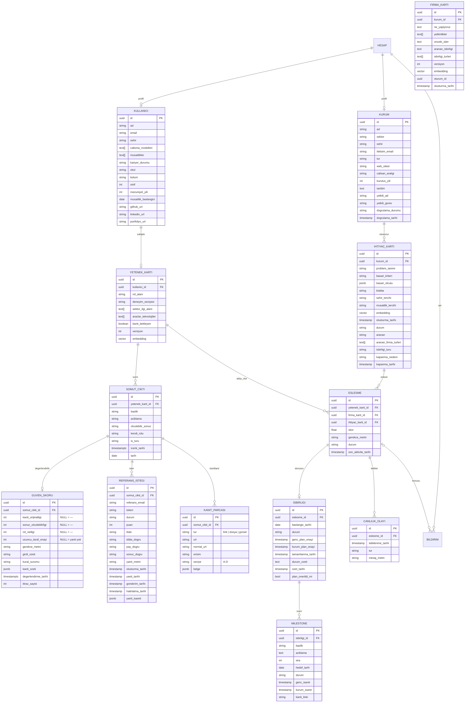

# Veri Şeması

## ER Diyagramı

## Tasarım Kararları

- **Genç akışı alanları (28-29 Eyl, `plans/genc-akisi.md` § 3).**
  - `HESAP.kvkk_onay_tarihi`.
  - `KULLANICI`'da kayıt formunun yapısal alanları (yukarıdaki diyagram). Fotoğraf, yaş, cinsiyet, medeni durum, TC kimlik no, adres ve ücret beklentisi bilinçli olarak yok; şema bu alanları 422 ile reddeder.
  - `YETENEK_KARTI.sertifikalar`, `diller`; `versiyon` her gerçek düzenlemede artar.
  - `SOMUT_CIKTI.is_turu`, `kendi_rolu`, `olculebilir_sonuc` (eskiden açıklamaya birleştiriliyordu; rubrik ve embedding birleşik okur, `app/core/is_kalemi.py`), `icerik_tarihi` (NULL = hiç değişmedi; değişince güven göstergesi sıfırlanır) ve `oturum_id` ("Yeni iş ekle" sohbeti için, ertelendi).
  - `REFERANS_ISTEGI.yanit_tarihi`: `icerik_tarihi`'nden önce verilmiş yanıt geçmişte kalır, puana girmez.
  - `ESLESME` ve `IHTIYAC_KARTI.durum` aşağıda.

- **`HESAP` (Faz B) — kimlik profilden ayrı.** `hesap(id, email UNIQUE, sifre_hash, rol, olusturma_tarihi, kvkk_onay_tarihi, eposta_dogrulandi_tarihi)`; `rol` ∈ `genc | kurum | girvak`. Genç hesabının bir `KULLANICI` profili, kurum hesabının bir `KURUM` profili olur (`hesap_id` UNIQUE FK, 1-1); GİRVAK hesabının profili yok. Şifre argon2id ile hash'lenir, düz şifre saklanmaz. `hesap_id` nullable: Faz B öncesi profiller için hesap uydurulmadı. Gerekçe ve iki seçeneğin karşılaştırması: `faz-b-kimlik-ve-dongu.md` § 1.
- **`EPOSTA_DOGRULAMA` (Doğrulama iyileştirmesi, adım 6) — kayıt e-postası bağlantısı.** `eposta_dogrulama(id, hesap_id FK CASCADE, token_ozeti UNIQUE, son_gecerlilik, olusturma_tarihi)`. Token'ın kendisi değil SHA-256 özeti saklanır. Hesap başına tek geçerli bağlantı (yenisi eskileri siler); 24 saat geçerli, doğrulamadan sonra süresi dolana kadar kalır (ikinci açılış yan etkisiz). Doğrulanınca `hesap.eposta_dogrulandi_tarihi` yazılır; gencin ad kilidi bu alandan türetilir, ayrıca saklanmaz (`plans/dogrulama-iyilestirme.md` § 6.3).
- **`BAGLI_HESAP` ve `PROFIL_KODU` (Doğrulama iyileştirmesi, adım 8) — hesap bağlama.** `bagli_hesap(id, kullanici_id FK CASCADE, saglayici, kullanici_adi, dis_kimlik, yontem, baglanma_tarihi)`; `saglayici` plan § 6.1'deki on bir türden biri (CHECK: `github`, `gitlab`, `orcid`, `youtube`, `kaggle`, `behance`, `dribbble`, `medium`, `vimeo`, `soundcloud`, `kisisel_site`), `yontem` ∈ `oauth | profil_kodu | elle` (elle: GİRVAK'ın doğruladığı kod). (`saglayici`, `dis_kimlik`) tekil: bir platform hesabı iki gence bağlanamaz. OAuth token'ı saklanmaz. `profil_kodu(id, kullanici_id FK CASCADE, platform, kod, profil_adresi, son_gecerlilik)`: (`kullanici_id`, `platform`) tekil, yenisi eskisinin yerine geçer, doğrulanınca silinir. Bağlı hesaptaki kanıt seviye B; `kanit_parcasi.sahiplik_kaynagi` (`oauth | profil_kodu | yok`) ve `platform` değerlendirmede yazılır. Profil okunamazsa `inceleme_isareti` (`profil_kodu_elle`; genç başına tek açık) açılır; GİRVAK'ın kararı bildirim türü `hesap_baglama_sonucu` ile gence gider.
- **`INCELEME_ISARETI` (Doğrulama iyileştirmesi, adım 6) — GİRVAK inceleme kuyruğu.** `inceleme_isareti(id, tur, kullanici_id FK CASCADE, somut_cikti_id FK CASCADE nullable, ayrinti JSONB, durum, girvak_notu, olusturma_tarihi, kapanma_tarihi)`. `tur` plan § 9'daki on türden biri (hepsi CHECK'te baştan tanımlı: `ayni_iddia_cok_hesapta`, `ayni_belge_iki_hesapta`, `gorsel_baskasinda`, `referans_supheli`, `belge_tutarsiz`, `kanit_celisiyor`, `itiraz_siniri`, `ad_degisikligi`, `profil_kodu_elle`, `edevlet_barkodu`; adım 9'da `eposta_barkodu` yazım hatası düzeltildi, migration `a6d2e9f4b7c1`). `durum` ∈ `acik | kapandi | dogrulanamadi`; geçiş `app/agents/inceleme_durumu.py`'de. Aynı (tür, genç, kalem) için tek açık işaret (kısmi tekil indeks, `NULLS NOT DISTINCT`): tekrar eden sinyal açık işaretin `ayrinti`'sına eklenir. İşaret puanı değiştirmez (İ1). Bildirim türleri `inceleme_sonucu`, `ad_degisikligi_sonucu`.
- **`ISBIRLIGI` ve `MILESTONE` (Faz C) — Takip.** `ISBIRLIGI.durum`: `plan_bekliyor` → `aktif` (iki taraf da mevcut planı onaylayınca; düzenleme iki onayı da sıfırlar) → `tamamlandi` (son adım iki tarafça tamamlanınca, kural; ajanın kararı değil). `MILESTONE.durum`: `bekliyor` → `tamamlandi` (genç ve kurum ayrı ayrı işaretler). **Gecikme saklanmaz**, okuma anında hesaplanır (`hedef_tarih < bugün` ve tamamlanmadı). Onaylanan plan kilitli; `aktif`'te yalnızca `kanit_linki` değişir. `durum_ozeti` Takip Ajanı'nın kesilebilir özeti, hiçbir kural ona bakmaz. **Tamamlanmış pilot** sinyali saklanmaz, `durum = tamamlandi` kayıtlarından hesaplanır ve Eşleştirme'nin doğrulama bonusuna girer (`matching-algorithm.md` § 4). Faz B'de `aktif` açılmış planı olmayan kayıtlar migration'la `plan_bekliyor` oldu. Bkz. `faz-c-takip.md`.
- **`BILDIRIM` (Faz B) — uygulama içi bildirim.** `bildirim(id, hesap_id FK CASCADE, tur, metin, eslesme_id FK nullable SET NULL, olusturma_tarihi, okundu_tarihi nullable)`. `tur` ∈ `yeni_oneri | ilgi | kabul | red | referans_yaniti` (Faz B), `referans_yanit_yok` (Doğrulama iyileştirmesi adım 7), `plan_onerildi | plan_duzenlendi | plan_onayi | plan_onaylandi | adim_isaretlendi | adim_tamamlandi | isbirligi_tamamlandi` (Faz C); Canlılık (Faz D) aynı tabloya kendi türleriyle yazar. `olusturma_tarihi` INSERT anında `clock_timestamp()` ile atanır: `now()` işlem başlangıcını döndüğü için aynı işlemde yazılan bildirimler eşit zamanlı kalıp sıra belirsizleşiyordu. Olayla aynı işlemde yazılır; aynı geçişin tekrarı yeni bildirim yazmaz. Metin e-posta taşımaz. Bildirim yalnızca uygulama içidir, e-postayla gönderilmez. Bkz. `faz-b-kimlik-ve-dongu.md` § 6.
- **Güven göstergesinde NULL "—" demektir, 0 değil** (Doğrulama iyileştirmesi adım 3; `plans/dogrulama-iyilestirme.md` § 1 İ4). Kanıt, Sonuç, Rol NULL: değerlendirilmedi ya da kanıt okunamadı. `ucuncu_taraf_onayi` NULL: güncel referans yanıtı yok; 0 ise referansın olumsuz yanıtı. Eski kayıtlardaki iki tür sahte sıfır (linksiz kaleme referans gelince açılan sıfırlı gösterge, yanıtsız referansın 0'ı) migration `7c4e2a9d1f63` ile NULL'a çevrildi. Eşleştirme bonusu yalnızca dolu başlıklardan hesaplanır (`matching-algorithm.md` § 4).
- **Kanıt `SOMUT_CIKTI`'da değil, `KANIT_PARCASI`'nda.** Eski `kanit_linki` ve `kanit_turu` kolonları genişlet → geçir → daralt ile kaldırıldı (migration'lar `3d998c849bba`, `b4f8d2e6a1c9`); tür, parçanın platformundan gelir.
- **`KANIT_PARCASI`**: bir iş kaleminin kanıtları (link, dosya, görsel); bir kalemin birden çok parçası olabilir, her başlıkta en güçlü parça kullanılır (`plans/dogrulama-iyilestirme.md` § 2, § 13). `normal_url` aynı sayfanın farklı yazımlarını tek biçime indirir; kalem içinde tekildir. Ayrıntılı alanlar ve `KANIT_METIN_PARCASI`, `YETENEK_KANITI` tabloları planın § 13'ünde. Dosya / görsel (adım 9): `dosya_anahtari` (depoda rastgele anahtar), `dosya_ozeti` (ham dosyanın SHA-256'sı, kalem içinde tekil), `tam_metin` (belgede yazan metin, maskelenmiş; alıntı kaynağı), `gorsel_metni` (model okuduysa), `gorunur_firmaya`; `belge` JSONB: `dosya` (ad, tür, boyut, tarama, sayfa, okuyan), `betim`, ön okuma (`exif` konumsuz, `kodlar`, `rozet`, `c2pa`) ve `capalar` (çapa başına gerçekler: `adres`, `imza`, `rozet`, `edevlet`). Dosyanın seviyesi saklanmaz, okuma anında çapalardan ve gencin kimlik durumundan hesaplanır (`agents/dogrulama/capalar.py`); `seviye` kolonu son değerlendirmenin okunuşudur. `phash` (adım 11): görselin algısal özeti (64 bit, 16 onaltılık karakter; temizlenmiş piksellerden, `core/gorsel_ozeti.py`), PDF'te boş; başka hesapta aynı `normal_url`, aynı `dosya_ozeti` ya da bit farkı ≤ 6 olan `phash` `ayni_iddia_cok_hesapta` işaretidir (iki parça da OAuth katkıcı listesiyle doğrulandıysa takım projesi, işaret değil). `belge.kaynak_aramasi` (adım 11, görselde ve arama yapıldıysa): `tarih`, `tam_eslesen_sayfa`, `baskasinda` (adres, başlık).
- **`SERVIS_KULLANIMI` (Doğrulama iyileştirmesi, adım 11) — ücretli dış servislerin aylık sayacı.** `servis_kullanimi(servis, donem, sayi)`, birincil anahtar (`servis`, `donem`); `donem` `YYYY-AA` (UTC). Çağrıdan önce tek koşullu sorguyla artırılır (`INSERT … ON CONFLICT DO UPDATE … WHERE sayi < tavan`); tavan dolunca çağrı yapılmaz. Bugün yalnızca `gorsel_arayici` (Cloud Vision, `GORSEL_ARAMA_AYLIK_TAVAN`). Migration `b9e4c2a7d1f3`.
- **`GUVEN_SKORU` ve `REFERANS_ISTEGI`, `SOMUT_CIKTI`'dan ayrı tablolar.** Bir çıktının birden fazla referans isteği olabilir; güven skoru zamanla güncellenebilir olmalı (itiraz sonrası yeniden hesaplama).
- **`ESLESME.durum` ve ilgi alanları (genç akışı, `plans/genc-akisi.md` § 4).** Değerler: `onerildi`, `genc_ilgilendi`, `ilgileniliyor`, `kabul_edildi`, `reddedildi`, `kapandi`; kural tek yerde (`app/agents/eslesme_durumu.py`). Karar `durum`'da; `baslatan` (`genc | kurum`), `genc_ilgi_tarihi`, `genc_iletisim_onayi_tarihi`, `kurum_ilgi_tarihi` yalnızca "kim, ne zaman" bilgisi. Tek alan seçildi çünkü pipeline, Canlılık, GİRVAK sayıları ve sahiplik `durum`'u okuyor. Karşılıklı ilgi `kabul_edildi`'dir. `IHTIYAC_KARTI.durum` (`acik | kapandi`): kapalı ihtiyaç eşleştirmeye girmez, bekleyen kayıtlar `kapandi` olur. `IHTIYAC_KARTI.aranan` (`genc | firma`, varsayılan `genc`): ilanın hangi kapıdan açıldığı; aynı tablo, aynı pipeline ve ilgi kuralları, fark aday kaynağında. Ortak ilanında `aranan_firma_turleri` (boş = hepsi) ve `isbirligi_turu`; çalışma modeli ve müsaitlik yalnızca genç ilanında (`plans/firma-akisi.md` § 0 kararlar 4-5). Firma kapatırken neden seçer (`kapanma_nedeni`: `platformda_bulundu | baska_yoldan_bulundu | vazgecildi`, `kapanma_tarihi`); neden yalnızca GİRVAK sayılarında görünür, kapanan ilan tekrar açılmaz (`plans/firma-akisi.md` § 7).
- **`KURUM` kayıt alanları (firma akışı, `plans/firma-akisi.md` § 2).** `tur` (`girisim | kobi | kurumsal`), `web_sitesi`, `calisan_araligi` (`1-10 | 11-50 | 51-250 | 250+`), `kurulus_yili`, `tanitim` (≤300), `yetkili_ad`, `yetkili_gorev`; hepsi nullable. Zorunluluk (tür, sektör, şehir) kayıt şemasında; eski hesaplarda boş olabilir, panel engellemeyen bir bantla ister. Vergi numarası, adres ve telefon bilinçli olarak toplanmaz. KVKK onayı gençteki gibi `hesap.kvkk_onay_tarihi`'nde. Kurallar `app/core/firma_profili.py`. **Doğrulama** (§ 6): `dogrulama_durumu` (`bekliyor | dogrulandi | simdilik_degil`, varsayılan `bekliyor`) ve GİRVAK'ın karar anı `dogrulama_tarihi`. Alan adı ipucu saklanmaz, okuma anında hesaplanır (`app/core/firma_dogrulama.py`, ağ isteği yok). Web sitesinin alan adı değişince `bekliyor`a döner. Dışarıya yalnızca `dogrulandi: bool` açılır; "şimdilik değil" firmaya "bekliyor"dan ayırt edilmez.
- **`FIRMA_KARTI` (firma akışı, `plans/firma-akisi.md` § 0 karar 10).** Firma başına bir kart (`kurum_id` UNIQUE), isteğe bağlı: yalnızca genç arayan firmanın karta ihtiyacı yok, kartı olmayan firma ortak olarak önerilmez. Yetenek kartı genişletilmedi; onun alanları gence özel. Paylaşılan kısım eşleşme, pipeline, ilgi kuralları ve iş birliği. Embedding firmanın **ne yaptığını** temsil eder (ne yapıyoruz, yetkinlikler, önceki işler, sektör); aradığı ortak ve iş birliği türü benzerlik metnine girmez. `versiyon` hazırlamanın tekrar korumasıdır; `oturum_id` UNIQUE, aynı sohbetin ikinci onayı mevcut kartı döner. Kurallar `app/core/firma_karti.py`.
- **`ESLESME` adayı: yetenek kartı ya da firma kartı** (firma akışı, `plans/firma-akisi.md` § 0 karar 11). `yetenek_karti_id` ve `firma_karti_id` nullable; CHECK `num_nonnulls(...) = 1` tam birini zorunlu kılar. İki UNIQUE: `(ihtiyac_karti_id, yetenek_karti_id)` ve `(ihtiyac_karti_id, firma_karti_id)`; pipeline'ın ON CONFLICT'i adayın türüne göre birine dayanır. Hangisinin dolacağını ilanın `aranan`'ı belirler. Durum makinesindeki `genc` rolü "aday tarafı" anlamındadır (karar 12): firma–firma'da aday firma bu taraftadır, kolon adları (`genc_ilgi_tarihi`, `baslatan='genc'`) değişmedi. Firma–firma'da iletişim `Iletisim.aday_firma_email`'de.
- **`ESLESME` → `ISBIRLIGI` ilişkisi isteğe bağlı (0 veya 1).** Her eşleşme iş birliğine dönüşmez — kurum "ilgileniyorum" der, iş birliği ancak genç kabul edince (`kabul_edildi`) açılır (docs/faz-b-kimlik-ve-dongu.md § 5).
- **`CANLILIK_OLAYI` doğrudan `ESLESME`'ye bağlı, `ISBIRLIGI`'na değil.** Pasiflik takibi bir iş birliği resmen başlamadan da çalışabilmeli — örn. "eşleşme önerildi ama kimse tıklamadı" durumu.
- **`kanit_bekleyen` (YETENEK_KARTI) ve `durum` (REFERANS_ISTEGI, ESLESME, ISBIRLIGI) alanları state machine mantığıyla çalışıyor.** Örn. `REFERANS_ISTEGI.durum`: `bekliyor` → `yanitlandi`, `yanit_yok` (zaman aşımı, ceza değil nötr durum) ya da `geri_cekildi` (genç; ör. yanlış adres; kanıt sayılmaz). `yanitlandi`, referansın yanıt verdiğini söyler — olumlu bulduğunu değil; olumsuz bir referans da bu durumda olur, değerlendirme `GUVEN_SKORU.ucuncu_taraf_onayi` puanında taşınır.
- **`embedding` (YETENEK_KARTI, IHTIYAC_KARTI), pgvector kolonu.** Kart onaylandığında/güncellendiğinde yeniden hesaplanır. **Sağlayıcı: Voyage AI (voyage-4, 1024 boyut)** — Anthropic'in Claude ile kullanım için resmi önerisi; ilk 200M token ücretsiz. `EMBEDDING_DIM = 1024` olarak sabitlenir (bkz. `matching-algorithm.md`).
- **`basari_olcutu` (IHTIYAC_KARTI), JSONB, nullable.** Başarı kriterinin parçaları: `metrik`, `mevcut_deger`, `hedef_deger`, `sure` (metin, firmanın ifadesiyle) ve `olcum_bilinmiyor` (firma ölçmediğini/bilmediğini söyledi). Model çıkarır, kural karar verir (`app/core/basari_olcutu.py`): "ölçülebilir mi" metne bakan bir düzenli ifadeyle değil hedef değerin varlığıyla anlaşılır. Hedef yoksa kart **"ölçüm yöntemi belirlenecek"** işaretini alır; işaret saklanmaz, yanıtta `olcum_belirlenecek` olarak hesaplanır. Bu alandan önceki kartlarda NULL ve işaretsiz (`b7e3a1c9d2f5`). `basari_kriteri` metni yerinde: gösterim ve embedding onu kullanır.
- **`sehir_tercihi` ve `musaitlik_tercihi` (IHTIYAC_KARTI), nullable.** Eşleştirme'nin sert filtre adımı SQL üzerinden çalışabilsin diye — serbest metin `kisitlar` alanı bu amaçla sorgulanamaz. `IHTIYAC_KARTI.sehir_tercihi` ile `KURUM.sehir` farklı şeyler: ilki gencin nerede olması istendiği (filtre), ikincisi kurumun kendi yeri (filtre değil). Arayüzde "aranan şehir" ve "kurumun şehri" olarak ayrı ayrı soruluyor; tercih boşsa kurumun şehri varsayılan geliyor.
- **`calisma_modelleri` (KULLANICI, çoklu) ve `calisma_modeli` (IHTIYAC_KARTI, tekli).** Değerler: `is_yerinde | hibrit | uzaktan`. Konumdan ayrı bir alan — önce şehir listesine "Uzaktan / fark etmez" diye bir seçenek konmuştu, ama bu "İstanbul'da ama hibrit" gibi çok sık bir durumu ifade edilemez kılıyordu; LinkedIn ve Kariyer.net de ikisini ayrı tutuyor. **Müsaitlikle karıştırma:** müsaitlik çalışma tipidir (tam/yarı zamanlı, proje bazlı, staj), bu ise çalışma yeri. Eşleştirme filtresi: ihtiyaç `uzaktan` ise şehir filtresi uygulanmaz ve gencin `uzaktan`ı kabul etmesi yeter; `is_yerinde`/`hibrit` ise hem şehir eşleşir hem genç o modeli kabul etmiş olmalıdır. Modelini hiç belirtmemiş kart elenmez (bilinmeyeni "hayır" saymak sessiz eleme olurdu). Eski `sehir = 'uzaktan'` kayıtları `0e3cd1cd3fdf` migration'ıyla yeni alana taşındı.
- **Müsaitlik kod olarak saklanıyor** (`KULLANICI.musaitlikler`, `IHTIYAC_KARTI.musaitlik_tercihi`; `app/core/musaitlik.py`): `tam_zamanli | yarim_zamanli | proje_bazli | staj`. Eşleştirme filtresi düz eşitlik yaptığı için Tanımlama Ajanı'nın serbest metni ("tam zamanlı") tüm adayları sessizce eliyordu — şehirdeki hatanın aynısı. Ajanın çıkarım şeması `Literal`; istemciden gelen onay katı okunur (tanınmayan değer 422), checkpoint'ten okunan eski taslak hoşgörülü okunur (tanınmayan değer NULL). Eski satırlar `7c3a9e51b8d4` migration'ıyla koda çevrildi, tanınmayan NULL oldu (filtre uygulanmaz, eleme olmaz). **Gencin tarafı çoklu seçim** (`musaitlikler text[]`, `76b95c6a1658`; tekil değer tek elemanlı listeye taşındı): ihtiyaç tek tercih taşır, filtre "tercih gencin listesinde mi" diye sorar; liste boşsa genç elenmez (çalışma modelindeki kural; eskiden müsaitliği boş genç, tercihi olan ihtiyaçta eleniyordu). Kural `musaitlik_uyar_mi`.
- **Şehir adları kanonik yazımda saklanıyor** (`app/core/sehir.py`, 81 il + `uzaktan`). Sebep: filtre düz string karşılaştırması ve Türkçe'de `'istanbul' = 'İstanbul'` false — `lower()` ve `ILIKE` de çözmüyor (Postgres bu collation'da İ'yi küçültmüyor, Python'ın `lower()`'ı ise i + U+0307 üretiyor). Kayıt anında `sehir_kanonik()` uygulanıyor, eski satırlar `a1c4f7e2b903` migration'ıyla düzeltildi. Liste yalnızca il adlarından oluşur; "uzaktan" bir şehir değil, çalışma modelidir.
- **`sektor_ilgi_alani`, `araclar_teknolojiler` (YETENEK_KARTI), `aciklama` (SOMUT_CIKTI), `token` (REFERANS_ISTEGI).** Faz 1'de backend iskeletini yazarken Claude Code'un dokümanlar arası çapraz kontrolde yakaladığı eksiklerdi — diğer dosyalar (`agent-specs.md`, `matching-algorithm.md`, `api-contracts.md`) bu alanlara referans veriyordu ama ER diyagramında yoktu. Buradan eklendi.
- **`email` (KULLANICI) ve `iletisim_email` (KURUM), UNIQUE ve normalize (`lower(trim)`).** Onay anında kayıt bu alanla tek bir `INSERT … ON CONFLICT DO UPDATE` ile yazılıyor: yarışa dayanıklı, kayıtlı kişinin yeni verdiği bilgi güncelleniyor. Boş gelen alan kayıtlı değeri silmiyor (skalerlerde `COALESCE`, `calisma_modelleri` boşsa eskisi kalıyor) — taslak birleştirmedeki kuralın aynısı. Eski mükerrerler `cb9a542b6431` migration'ıyla birleştirildi (kartlar en küçük `id`'li kayda taşındı). Bu "e-postayla bul" mantığı Faz B'de hesaba bağlanınca kalkacak.
- **`iletisim_email` (KURUM).** `KULLANICI.email`'in kurum karşılığı — Keşif Ajanı'nda kart onaylanırken email üzerinden `Kullanici` bulunup/oluşturuluyordu, Tanımlama Ajanı'nda `Kurum` için aynı mekanizma gerekiyor. Tanımlama Ajanı'nın backend'i yazılırken fark edildi.
- **`puan` (REFERANS_ISTEGI) ve çok referanslı hesap.** Referansın 1-5 puanı kaydediliyor, çünkü `GUVEN_SKORU.ucuncu_taraf_onayi` tek bir yanıttan değil, **yanıtlamış tüm referansların ortalamasından** hesaplanıyor (1-5 → 0-3 çevrimi sonrası, 0.5 yukarı yuvarlanarak). En yüksek puanı almak "olumlu diyen birini bulana kadar referans sor" davranışını ödüllendirirdi; ortalama, zayıf bir referansın puanı aşağı çekmesine izin verir. Yuvarlama aşağı değil normal: aşağı yuvarlamada iki güçlü referans (5+4 → 2.5 → 2) tek bir 5'ten (3) düşük puan alıyordu — referans eklemek iddiayı zayıflatmamalı. Puan saklanmadan bu hesap yapılamıyordu — son yanıt öncekinin üzerine yazıyordu. Doğrulama Ajanı denenirken fark edildi.
- **4 soruluk referans formu (REFERANS_ISTEGI, Doğrulama iyileştirmesi adım 7; migration `e4a9c7b2d5f1`).** `iliski` ∈ `yonetici | takim_arkadasi | ogretmen_danisman | musteri | diger`; `iddia_dogru`, `pay_dogru`, `sonuc_dogru` ∈ `evet | kismen | hayir | bilmiyorum` (kalemde yazılmamış pay / sonuç sorulmaz, NULL). Değer kümeleri ve `durum` CHECK'li. Referans başlığı: evet 3, kısmen 1, hayır 0, bilmiyorum ortalamaya girmez, kişi başına ortalama; eski satırların `puan`'ı (1-5) eşlemeyle okunmaya devam eder. `gonderim_tarihi` e-postanın kuyruğa verildiği an (NULL: adım 7'den önce açılmış, link gence verilmişti; bunlara hatırlatma gitmez), `hatirlatma_tarihi` 3. gündeki tek hatırlatma. `yanit_isareti` şüphe sinyalleri için (adım 11). Güç işareti (kurumsal / eğitim e-postası) saklanmaz, adresten okuma anında hesaplanır. Yanıt `UPDATE … WHERE durum = 'bekliyor' RETURNING id` ile yazılır. Token hiçbir API yanıtında yok. Bildirim türü `referans_yanit_yok` (gence, nötr).
- **`olusturma_tarihi` (REFERANS_ISTEGI).** Zaman aşımı dalı (`bekliyor` → `yanit_yok`, 5-7 gün) bir tarih olmadan hesaplanamıyordu. Ayrı bir zamanlayıcı kurulmadığı için bu geçiş okuma anında hesaplanıyor; alan onun dayanağı. Doğrulama Ajanı yazılırken eklendi.
- **`kullanici_id` (YETENEK_KARTI) UNIQUE: gencin tek kartı** (1 Eki, Keşif incelemesi madde 7). Genç yeni kart açmaz; kartını düzenler ve çalışma ekleyerek güçlendirir, böylece aynı ilanın önerilerinde iki kez çıkmaz. Kural veritabanında ki eşzamanlı iki onay da ikinci kartı açamasın; Keşif kartı olan gence 409 döner, `/me` tek `yetenek_karti` taşır. Migration (`a3d7e1c9b5f2`) tekrar eden kart varsa durur, veri silmez.
- **`oturum_id` (YETENEK_KARTI, IHTIYAC_KARTI), nullable + UNIQUE.** Kartı doğuran sohbetin kimliği. Onay tekrarlanabilir olsun diye: aynı sohbet ikinci kez onaylanınca (çift tıklama, embedding hatası sonrası yeniden deneme) yeni kart açılmaz, mevcut kart döner. Eşzamanlı iki onayda ikincisi UNIQUE kısıta takılır ve mevcut kartı alır. Faz A'da inceleme bulgusu olarak eklendi.
- **`(ihtiyac_karti_id, yetenek_karti_id)` (ESLESME), UNIQUE.** Bir çift için tek eşleşme. Arka plan eşleştirmesi ile öneri okuması aynı anda çalışınca mükerrer satır açılıyordu; pipeline artık ihtiyaç kartı başına advisory lock ile sıraya giriyor, yeni satırlar `ON CONFLICT DO NOTHING` ile yazılıyor.
- **`olusturma_tarihi` (IHTIYAC_KARTI).** Eşleştirme Ajanı "kurumun en son ihtiyaç kartı"nı bulmak için `id` sırasına bakıyordu — ama `id` rastgele üretilen bir UUID (v4), zaman bilgisi taşımıyor, sıralaması kronolojik değil. Eşleştirme Ajanı yazılırken fark edildi, gerçek bir tarih alanıyla düzeltiliyor.
