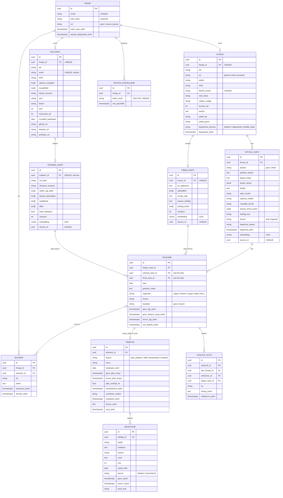
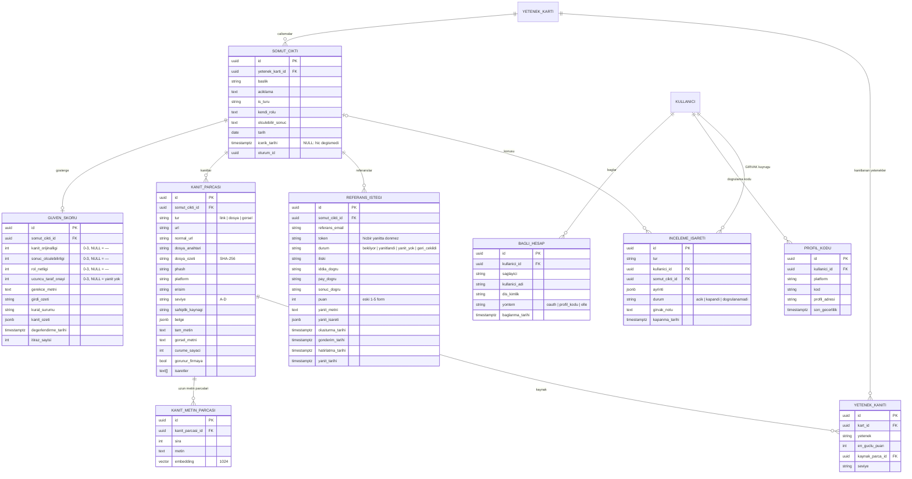

# Veri Şeması

25 tablo, PostgreSQL + pgvector. Modeller `backend/app/models/` (tablo başına bir dosya),
migration'lar `backend/alembic/versions/`. LangGraph'ın sohbet checkpoint tabloları
(`checkpoints`, `checkpoint_writes`…) kütüphaneye aittir, Alembic'e girmez.

Diyagramlar okunur kalsın diye üçe bölündü; kolonlar modellerle birebir aynıdır.

## 1. Kimlik, kartlar, eşleşme ve iş birliği

## 2. Doğrulama

## 3. Gözlem ve sayaçlar (ilişkisiz, kişi taşımaz)

| Tablo | Kolonlar | Ne için |
|---|---|---|
| `kanit_gozlemi` | `tarih`, `kaynak`, `platform`, `okuyucu`, `erisim`, `seviye`, `sure_ms`, `girdi_ozeti` | Her link okuması; platform bazında erişim dağılımı |
| `degerlendirme_gozlemi` | `tarih`, `girdi_ozeti`, `parca_sayisi`, `sure_ms`, `model_cagrisi`, `girdi_token`, `cikti_token` | Modelin çağrıldığı her değerlendirme |
| `servis_gunlugu` | PK (`servis`, `gun`), `basari_sayisi`, `hata_sayisi`, `son_basari`, `son_hata`, `son_hata_turu` | Dış servis başına günlük sayaç |
| `servis_kullanimi` | PK (`servis`, `donem`), `sayi` | Ücretli servislerin aylık tavanı |

Gözlem kayıtları 90 gün sonra Canlılık taramasında silinir (`canlilik.md` § 4).

## Tasarım Kararları

### Kimlik ve profil

- **Kimlik profilden ayrı.** `hesap` giriş bilgisini ve rolü taşır; genç hesabının `kullanici`,
  firma hesabının `kurum` profili olur (`hesap_id` UNIQUE, 1-1); GİRVAK'ın profili yok. Şifre
  argon2id ile hash'lenir. `hesap_id` boş bırakılabilir: kimlik tablosundan önceki profiller için
  hesap uydurulmadı, hesapsız profilin kartı eşleştirmeye girmez. Gerekçe: `kimlik-ve-dongu.md` § 1.
- **Toplanmayan kişisel veri.** Fotoğraf, yaş, cinsiyet, medeni durum, TC kimlik no, adres ve ücret
  beklentisi gençten; vergi numarası, adres ve telefon firmadan bilinçli olarak alınmaz. Şema bu
  alanları reddeder.
- **E-posta doğrulama:** token'ın kendisi değil SHA-256 özeti saklanır; hesap başına tek geçerli
  bağlantı, 24 saat. Doğrulanınca `hesap.eposta_dogrulandi_tarihi` yazılır; gencin ad kilidi bu
  alandan türetilir, ayrıca saklanmaz.
- **`kullanici.email` ve `kurum.iletisim_email`** iletişim bilgisidir; normalize (`lower(trim)`) ve
  tekil. Kimlik onlarla bulunmaz.
- **Firma doğrulaması:** `dogrulama_durumu` ve GİRVAK'ın karar anı. Alan adı ipucu saklanmaz, okuma
  anında hesaplanır (`app/core/firma_dogrulama.py`); web sitesinin alan adı değişince `bekliyor`a
  döner. Dışarıya yalnızca `dogrulandi: bool` açılır (`kararlar.md` F6).

### Kartlar

- **Gencin tek kartı** (`yetenek_karti.kullanici_id` UNIQUE, `kararlar.md` G17): kural veritabanında,
  eşzamanlı iki onay da ikinci kartı açamaz.
- **Firma kartı ayrı tablo** (`kararlar.md` F10): firma başına bir, isteğe bağlı. Embedding firmanın
  ne yaptığını temsil eder (ne yapıyoruz, yetkinlikler, önceki işler, sektör); aradığı ortak benzerlik
  metnine girmez.
- **`oturum_id` UNIQUE:** kartı doğuran sohbetin kimliği. Aynı sohbetin ikinci onayı (çift tıklama,
  embedding hatası sonrası yeniden deneme) yeni kart açmaz, mevcut kartı döner.
- **`versiyon`** her gerçek düzenlemede artar; arka plan işlerinin tekrar korumasıdır.
- **`embedding`** (1024 boyut, Voyage) kart onaylanınca ve düzenlenince yeniden hesaplanır;
  hesaplanamazsa kart yine kaydedilir, embedding'i boş kart eşleştirmeye girmez.
- **İhtiyaç kartının kapısı** (`aranan`: `genc | firma`, `kararlar.md` F4): aynı tablo, aynı pipeline;
  fark aday kaynağında. Ortak ilanında `aranan_firma_turleri` (boş = hepsi) ve `isbirligi_turu`;
  çalışma modeli ve müsaitlik yalnızca genç ilanında.
- **İhtiyaç kapanır, tekrar açılmaz** (`durum`, `kapanma_nedeni`, `kapanma_tarihi`; `kararlar.md` F7).
  `hatali_girildi` giriş hatasıdır, GİRVAK sayılarında ayrı gösterilir.
- **`basari_olcutu`** (JSONB): başarı kriterinin parçaları (`metrik`, `mevcut_deger`, `hedef_deger`,
  `sure`, `olcum_bilinmiyor`). Model çıkarır, kural karar verir (`app/core/basari_olcutu.py`): hedef
  değer yoksa ilan "ölçüm yöntemi belirlenecek" işaretini alır; işaret saklanmaz, yanıtta
  hesaplanır.
- **`olusturma_tarihi`** gerçek bir tarih alanı: UUID v4 kronolojik değil, "en son kart" ona göre
  bulunur.

### Eşleştirme filtreleri

- **Şehir kanonik yazımda** (`app/core/sehir.py`, 81 il). Filtre düz karşılaştırma ve Türkçe'de
  `'istanbul' = 'İstanbul'` yanlış; `lower()` ve `ILIKE` de çözmüyor (Postgres bu collation'da İ'yi
  küçültmüyor, Python'ın `lower()`'ı i + U+0307 üretiyor). Kayıt anında `sehir_kanonik()` uygulanır.
- **Çalışma modeli konumdan ayrı** (`is_yerinde | hibrit | uzaktan`; gençte çoklu, ilanda tekli).
  İlan `uzaktan` ise şehir filtresi uygulanmaz; değilse hem şehir eşleşir hem genç o modeli kabul
  etmiş olmalı. "İstanbul'da ama hibrit" gibi sık bir durum şehir listesine "uzaktan" seçeneği
  koyarak ifade edilemiyordu.
- **Müsaitlik kod olarak** (`tam_zamanli | yarim_zamanli | proje_bazli | staj`, `app/core/musaitlik.py`);
  gençte çoklu seçim. Serbest metin ("tam zamanlı") düz eşitlik filtresinde bütün adayları sessizce
  eliyordu. Çıkarım şeması `Literal`; istemciden gelen onay katı okunur (422), checkpoint'ten okunan
  eski taslak hoşgörülü.
- **Bilinmeyen elenme nedeni değildir:** çalışma modeli ya da müsaitlik listesi boş olan genç elenmez;
  bilinmeyeni "hayır" saymak sessiz eleme olurdu.
- **`sehir_tercihi`** (ilanda, gencin nerede olması istendiği; filtre) ile **`kurum.sehir`** (firmanın
  yeri; filtre değil) farklı şeylerdir; tercih boşsa firmanın şehri varsayılan gelir.

### Eşleşme

- **Durum tek alanda** (`onerildi`, `genc_ilgilendi`, `ilgileniliyor`, `kabul_edildi`, `reddedildi`,
  `kapandi`); kural `app/agents/eslesme_durumu.py`'de. Pipeline, Canlılık, GİRVAK sayıları ve sahiplik
  aynı alanı okur. `baslatan` ve tarih kolonları yalnızca "kim, ne zaman" bilgisidir.
- **Aday yetenek kartı ya da firma kartıdır, tam biri dolu** (CHECK `num_nonnulls(...) = 1`). İki
  UNIQUE: (`ihtiyac_karti_id`, `yetenek_karti_id`) ve (`ihtiyac_karti_id`, `firma_karti_id`). Bir çift
  için tek eşleşme: pipeline ihtiyaç başına danışma kilidiyle sıraya girer, yeni satırları
  `ON CONFLICT DO NOTHING` ile yazar.
- **`genc_*` kolonları "aday tarafı" demektir** (`kararlar.md` F12): firma–firma'da aday firma bu
  taraftadır.
- **`uygunluk`:** `uygun_degil` saklanır ama hiçbir okumada görünmez (`gorunur_kosulu()`); NULL
  "bilinmiyor" demektir, öneri listelenir (`matching-algorithm.md` § 8).
- **İş birliği isteğe bağlıdır (0 ya da 1)** ve yalnızca `kabul_edildi` ile açılır.
- **Canlılık olayı eşleşmeye bağlıdır**, iş birliğine değil: hareketsizlik iş birliği başlamadan da
  izlenebilmeli ("önerildi ama kimse bakmadı").

### Takip

- **Gecikme ve tamamlanmış iş birliği sinyali saklanmaz**, okuma anında hesaplanır; tek doğruluk
  kaynağı `isbirligi.durum` ve `milestone.hedef_tarih`. Onaylanan plan kilitli; `aktif`'te yalnızca
  `kanit_linki` değişir. `durum_ozeti` kesilebilir: hiçbir kural ona bakmaz (`takip.md`).

### Bildirim

- **Olayla aynı işlemde yazılır**; aynı geçişin tekrarı yeni bildirim yazmaz; metin e-posta taşımaz.
  `olusturma_tarihi` INSERT anında `clock_timestamp()`: `now()` işlem başlangıcını döndüğü için aynı
  işlemdeki bildirimlerin sırası belirsizleşiyordu.

### Doğrulama

- **Güven göstergesinde NULL "—" demektir, 0 değil** (`dogrulama.md` § 1, İ4). Kanıt, Sonuç, Rol NULL:
  değerlendirilmedi ya da kanıt okunamadı. `ucuncu_taraf_onayi` NULL: güncel referans yanıtı yok; 0
  referansın olumsuz yanıtıdır. Eşleştirme bonusu yalnızca dolu başlıklardan hesaplanır.
- **Kanıt çalışmada değil, `kanit_parcasi`'nda:** bir çalışmanın birden çok parçası (link, dosya,
  görsel) olabilir, her başlıkta en güçlü parça kullanılır. `normal_url` aynı sayfanın farklı
  yazımlarını tek biçime indirir, kalem içinde tekil; `dosya_ozeti` de öyle. Dosyanın seviyesi
  saklanmaz, okuma anında çapalardan ve gencin kimlik durumundan hesaplanır; `seviye` son
  değerlendirmenin okunuşudur. `phash` görselin algısal özetidir; başka hesapta aynı adres, aynı dosya
  ya da çok yakın `phash` `ayni_iddia_cok_hesapta` işaretidir.
- **`icerik_tarihi`:** çalışmanın iddiası değişince yazılır; bu tarihten önce verilmiş referans yanıtı
  geçmişte kalır, puana girmez (`kararlar.md` G8).
- **Referans puanı ortalamadır:** `ucuncu_taraf_onayi`, güncel yanıt veren bütün referansların
  ortalamasıdır (evet 3, kısmen 1, hayır 0; "bilmiyorum" girmez; 0.5 yukarı yuvarlanır). En yüksek
  puanı almak "olumlu diyen birini bulana kadar sor" davranışını ödüllendirirdi; aşağı yuvarlamada iki
  güçlü referans tek bir referanstan düşük puan alıyordu. Eski 1-5 yanıtlar eşlemeyle okunur.
- **Referans formu:** `iliski` ve üç soru (`iddia_dogru`, `pay_dogru`, `sonuc_dogru`), değer kümeleri ve
  `durum` CHECK'li. Yanıt `UPDATE … WHERE durum = 'bekliyor' RETURNING id` ile yazılır (iki sekmeden
  yalnızca biri). `olusturma_tarihi` zaman aşımının (7 gün, okuma anında) dayanağıdır. Token hiçbir
  API yanıtında yoktur.
- **`yanit_isareti`:** `referans_supheli` sinyalleri; IP ve tarayıcı bilgisi yalnızca tuzlu HMAC özeti
  olarak, 90 gün tutulur, sinyaller kalır.
- **Hesap bağlama:** (`saglayici`, `dis_kimlik`) tekil: bir platform hesabı iki gence bağlanamaz.
  OAuth token'ı saklanmaz. Profil kodu (`kullanici_id`, `platform`) başına tektir, doğrulanınca silinir.
- **İnceleme işareti:** aynı (tür, genç, çalışma) için tek açık işaret (kısmi tekil indeks,
  `NULLS NOT DISTINCT`); tekrar eden sinyal açık işaretin `ayrinti`'sına eklenir. İşaret puanı
  değiştirmez (İ1).
- **Link çürümesi** yeni tablo istemez: `kanit_parcasi.curume_sayaci` ve `belge` JSONB'sinde yoklama
  tarihi ile puan geçmişi (`dogrulama.md` § 10.4).
- **Servis kullanımı** çağrıdan önce tek koşullu sorguyla artırılır (`INSERT … ON CONFLICT DO UPDATE
  … WHERE sayi < tavan`); tavan dolunca çağrı yapılmaz.
