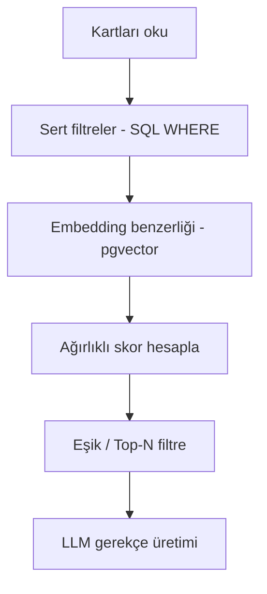

# Eşleştirme Algoritması

Bu doküman, `agent-specs.md`'deki 7 adımlı pipeline'ın uygulama düzeyinde detayıdır. Kapsam iki katmana ayrılmıştır: **MVP çekirdek** (Faz 2'de yazılacak, ESCO taksonomisi olmadan çalışır) ve **isteğe bağlı geliştirme** (zaman kalırsa eklenir). Bu ayrım bilinçli — projenin en riskli parçasını önce en sade haliyle çalışır kılmak, sonra zenginleştirmek.



## 1. Temsil Metni (embedding'e hazırlama)

Her kart, embedding'e verilmeden önce tek bir düz metne dönüştürülür.

**Yetenek kartı şablonu:**
```
Rol: {rol_alani}
Deneyim: {deneyim_seviyesi}
Sektör ilgisi: {sektor_ilgi_alani}
Araçlar: {araclar_teknolojiler}
Öne çıkan çıktılar: {somut_ciktilar[].baslik ve aciklama, birleştirilmiş}
```

**İhtiyaç kartı şablonu:**
```
Problem: {problem_tanimi}
Başarı kriteri: {basari_kriteri}
```

## 2. Embedding Üretimi

- Temsil metni, Voyage AI'nin `voyage-4` modeline gönderilir (1024 boyut) — Anthropic'in Claude ile kullanım için resmi önerdiği sağlayıcı, ilk 200M token ücretsiz.
- Sonuç vektör, kartın `embedding` kolonuna yazılır (pgvector).
- **Ne zaman yeniden hesaplanır:** kart onaylandığında (ilk oluşturma) ve her güncellemede (`versiyon` arttığında).

## 3. Sert Filtreler (embedding'den ÖNCE çalışır)

```sql
SELECT yk.* FROM yetenek_karti yk
JOIN kullanici k ON k.id = yk.kullanici_id
WHERE (ih.musaitlik_tercihi IS NULL
       OR cardinality(k.musaitlikler) = 0          -- genç belirtmemiş: elenmez
       OR ih.musaitlik_tercihi = ANY(k.musaitlikler))
  AND (ih.sehir_tercihi IS NULL OR k.sehir = ih.sehir_tercihi)
```

Bu adım havuzu daralttıktan sonra benzerlik hesabı sadece bu alt kümede çalışır — hem doğru hem performanslı.

## 4. Skor Formülü (MVP — ESCO'suz)

```
skor = 0.75 * cosine_similarity(yetenek.embedding, ihtiyac.embedding)
     + 0.25 * dogrulama_bonus
```

`dogrulama_bonus` hesabı:
- Çalışma başına oran: **dolu başlıkların toplamı / (3 × dolu başlık sayısı)** (0-1 arası). Boş başlık (NULL, arayüzde "—": değerlendirilmedi ya da referans yanıtı yok) ne ceza ne bonus: paydaya da girmez. Dört başlık doluysa sonuç eski `toplam / 12`'nin aynısıdır. Hiç dolu başlığı olmayan çalışma ortalamaya girmez. (Doğrulama iyileştirmesi adım 3, bulgu 17: değerlendirilmemiş başlıklar 0 sayılınca referans eklemek bile kartın bonusunu düşürüyordu.)
- `dogrulama_bonus` = çalışma oranlarının ortalaması.
- Göstergesi olan çalışma yoksa (henüz doğrulanmamış): `0` — **ceza değil**, sadece bonus yok. Doğrulanmamış kart elenmez, listede kalır.
- Kart için "en güçlü iki çalışmanın ortalaması" ya da yetenek bazlı kanıt seçenekleri Eşleştirme incelemesinde değerlendirilecek (`plans/dogrulama-iyilestirme.md` § 11.1).

**Tamamlanmış pilot (Faz C, `faz-c-takip.md` § 6):** kartın en az bir tamamlanmış iş birliği varsa bonusa toplamsal eklenir, tavan 1.0:

```
dogrulama_bonus = min(1.0, guven_orani + 0.5 × [tamamlanan_pilot ≥ 1])
```

Pilotu olmayan kartın skoru Faz C öncesiyle birebir aynı (demo kalibrasyonu bozulmaz); pilot skora en çok `0.25 × 0.5 = +0.125` ekler. Sayı değil varlık sayılır: bir pilot yeter. Sinyal saklanmaz, `isbirligi.durum = tamamlandi` kayıtlarından hesaplanır (`tamamlanan_pilot_sayilari`). Alakayı yaratmaz: benzerlik alt sınırı (§ 5) skordan önce uygulanmaya devam eder. Gerekçe istemine de "Tamamlanmış pilot: N" satırı gider.

## 5. Eşik ve Sıralama

> **Karar verilmiş kayıtlar korunur** (`plans/genc-akisi.md` § 0 karar 14). Yeniden hesap yalnızca `onerildi` kayıtlarını siler ve en iyi 5 sınırı yalnızca onlara uygulanır. Kurumun karar verdiği kayıtlarda (`ilgileniliyor`, `kabul_edildi`, `reddedildi`) yalnızca skor tazelenir; gencin ilgi gösterdiği kayıtta (`genc_ilgilendi`) skor ve gerekçe de değişmez, kayıt ilk 5'in dışına düşse de firmanın "İlgi gösterenler" listesinde kalır. Kapalı ihtiyaç için aday aranmaz.
>
> **Bilinen sınır:** ilk 5 (`TOP_N`) ihtiyaç başınadır; sıralamada 6. ve sonrası olan genç o ihtiyacı fırsat olarak görmez (`plans/genc-akisi.md` § 0 karar 3).

Mutlak bir eşik yerine (havuz küçükken saçmalar) **Top-N** yaklaşımı: en yüksek skorlu **5 sonuç** gösterilir. Ek güvenlik: skor %40'ın altındaysa hiç gösterilmez (tamamen alakasız sonuçları filtrelemek için).

### Benzerlik alt sınırı: 0.45 (skordan önce uygulanır)

Skor eşiği tek başına yetmiyor. Formül gereği tam doğrulanmış bir kart, benzerliği sıfır olsa bile `0.25 × 1.0 = 0.25` taşıyor; 0.34 benzerlikli alakasız bir aday `0.75 × 0.34 + 0.25 × 0.75 ≈ 0.44` ile %40 eşiğini geçiyordu. Sonuç: konuyla ilgisi olmayan bir kart öneri listesine giriyor, üstüne LLM ona bir gerekçe yazmaya çalışıyordu.

**Kural:** doğrulama bonusu **alakalı adaylar arasında sıralamayı** etkiler; alakasız bir adayı alakalı yapmaz. Bu yüzden `benzerlik < 0.45` olan adaylar **skor hesaplanmadan** elenir (`BENZERLIK_ALT_SINIRI`, `app/agents/eslestirme.py`). İki sınır farklı şeyleri ölçüyor ve biri diğerinin yerine geçmiyor: 0.45 "bu aday konuyla ilgili mi", %40 "ilgili adaylar arasında gösterilmeye değer mi".

Değer mevcut kartların ham benzerlikleriyle kalibre edildi (Voyage `voyage-4`, Türkçe metin):

| Çift | Benzerlik |
|---|---|
| Destek bileti ihtiyacı ↔ bilet sınıflandırma botu (gerçekten alakalı) | 0.662 |
| Aynı ihtiyaç ↔ kütüphane takip sistemi | 0.340 / 0.336 |
| Aynı ihtiyaç ↔ veri analisti kartı | 0.342 |
| Zeytin budama takibi ↔ tüm kartlar (kasten alakasız) | 0.275 – 0.354 |

Alakasız küme 0.27–0.36 bandında toplanıyor, gerçek eşleşme 0.66'da duruyor. 0.45, gürültü bandının ~0.09 üstünde ve gerçek eşleşmenin ~0.21 altında — iki tarafa da pay bırakıyor. Kısmen alakalı adaylar (aynı beceri, farklı alan) bu bandın neresine düşer, havuz büyüyünce yeniden bakılmalı; dört kartlık bir örneklemle kalibre edildiğini unutma.

Alt sınır ayrıca SQL sorgusunda da uygulanıyor (havuz Python'a taşınmadan daralsın diye), ama kuralın tek doğruluk kaynağı `siralayip_ele`.

**Cold start:** havuzda az kart varken bu doğal bir sınırlama — arayüzde gizlenmez, açıkça belirtilir: *"Şu an sınırlı sayıda eşleşme var."*

## 6. Gerekçe Üretimi (LLM)

LLM'e verilenler: ihtiyaç kartı özeti, yetenek kartı özeti, doğrulama özeti. İstenen çıktı: 2-3 cümlelik, somut noktalara referans veren bir gerekçe — genel geçer ifadeler değil ("iyi bir aday" gibi), kartlardaki gerçek alanlara atıf yapan cümleler.

**Doğrulama özeti ikili değil.** Eskiden "kanıtları doğrulandı / doğrulanmadı" gidiyordu ve güven skoru kaydı olan her kart "doğrulandı" sayılıyordu — kanıt orijinalliği 1/3 (link iddiayla ilgisiz) olsa bile; model de kartı "doğrulanmış" diye anlatıyordu. Artık çıktı başına dört rubrik puanı, rubriğin kendi tanımlarıyla cümleye çevrilip gönderiliyor ("kanıt linki açılıyor ama iddiayla ilişkisi zayıf" gibi) ve en altta tek bir "Genel" satırı var.

**Güçlü kanıt** (modelin "doğrulanmış" diyebileceği durum): kanıt orijinalliği 3/3 *ya da* üçüncü taraf onayı 2-3 (bir referansın olumlu yanıtı da doğrulamadır). Ölçülebilirlik ve rol netliği iddianın ne kadar açık yazıldığını ölçer, doğruluğunu değil; bu karara girmez.

**Koruma:** güçlü kanıt yokken gerekçe "doğrulanmış / doğrulandı / kanıtlanmış" derse düzeltme notuyla bir kez yeniden üretilir; yine derse öneri gerekçesiz gösterilir (skor geçerli kalır, sonraki hesapta yeniden denenir). Kuruma yanlış bir "doğrulandı" göstermektense gerekçesiz öneri daha iyi. İstemin kendi başına işlediği `CANLI_TEST=1` ile çalışan bir testle ölçülüyor.

## 7. Firma–firma eşleştirme (firma akışı)

Plan: `plans/firma-akisi.md` § 0 kararlar 5, 11-14; § 4. Aynı pipeline (`app/servisler/eslestirme.py`), aynı kilit, aynı temizlik ve karar 14 koruması; fark aday kaynağında: ilanın `aranan`'ı `firma` ise adaylar firma kartları (`firma_adaylarini_getir`).

- **Temsil metni:** firma kartı firmanın **ne yaptığını** anlatır: ne yapıyoruz, yetkinlikler, önceki işler, sektör (`firma_temsil_metni`). Aradığı ortak ve iş birliği türü girmez. İlan tarafı aynı: problem + başarı kriteri.
- **Kesin şartlar (SQL, benzerlikten önce):** kartı ve hesabı olan firma; ilanı açan firma değil; ilan tür seçtiyse `kurum.tur` o türlerden; ilan şehir şartı koyduysa `kurum.sehir` eşit (varsayılan "fark etmez"). Sektör şart değil.
- **Skor:** aynı formül, `0.75 × benzerlik + 0.25 × bonus`; aynı benzerlik alt sınırı (0.45), eşik (%40) ve ilk 5. Bonus: GİRVAK'ın doğruladığı firma +0.5, aday olarak en az bir tamamlanmış iş birliği +0.5, tavan 1.0. Bonus alakayı yaratmaz.
- **Gerekçe:** ayrı istem (`FIRMA_GEREKCE_SABLONU`), ilanı açan firmaya hitaben, aday firmadan üçüncü şahısla. Doğrulanmamış firmayı "doğrulanmış" diye anlatırsa bir kez düzeltme notuyla yeniden üretilir; yine olursa gerekçesiz kalır (genç gerekçesindeki koruma).
- **Ne zaman çalışır:** ortak ilanı onaylanınca (o ilan için) ve firma kartı onaylanınca/içeriği değişince (kartla ilgili açık ortak ilanları için; `servisler/firma_karti.py`). Kart içeriği değişince bekleyen önerilerin gerekçesi boşaltılır.
- **Ayrım:** gençler ortak ilanına, firmalar genç ilanına önerilmez.
- **Bilinen sınırlar:** 0.45 alt sınırı firma metinleri için ölçülmedi. Firma profili (tür, şehir, doğrulama) değişince mevcut öneriler kendiliğinden yeniden hesaplanmaz; bir sonraki pipeline çalışmasında güncellenir.

## İsteğe Bağlı Geliştirme — ESCO Taksonomi Eşleme

Zaman kalırsa (Faz 3 veya sonrası), skor formülüne bir bileşen daha eklenir:

```
skor = 0.55 * cosine_similarity
     + 0.20 * esco_orani
     + 0.25 * dogrulama_bonus
```

`esco_orani`: kartların serbest metnindeki beceri ifadelerinin, ESCO'nun Türkçe beceri listesiyle embedding benzerliği üzerinden eşlenen oranı (LLM çağrısı gerektirmeyen, daha ucuz bir yöntem — kart metni değil, tekil beceri ifadeleri ESCO terimleriyle karşılaştırılır).

**Bu adım MVP'yi bloklamaz** — cosine similarity zaten kartın tamamındaki serbest metni temsil ettiği için, ESCO olmadan da anlamlı eşleşmeler üretir.
