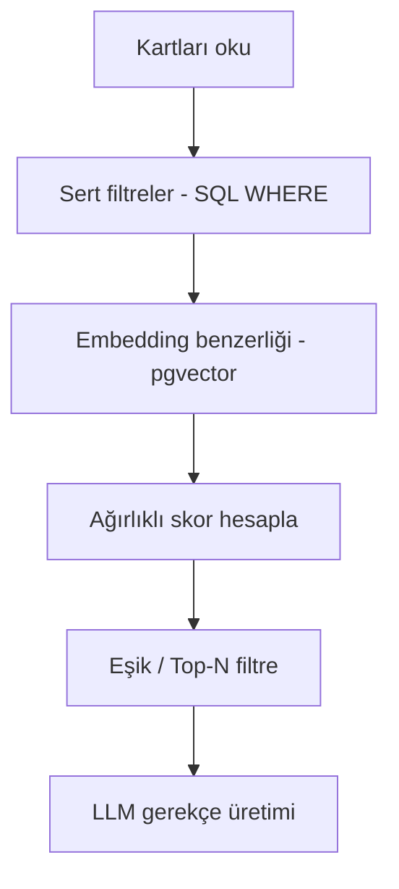

# Eşleştirme Algoritması

Bu doküman, `agent-specs.md`'deki 7 adımlı pipeline'ın uygulama düzeyinde detayıdır. Kapsam iki katmana ayrılmıştır: **MVP çekirdek** (Faz 2'de yazılacak, ESCO taksonomisi olmadan çalışır) ve **isteğe bağlı geliştirme** (zaman kalırsa eklenir). Bu ayrım bilinçli — projenin en riskli parçasını önce en sade haliyle çalışır kılmak, sonra zenginleştirmek.



## 1. Temsil Metni (embedding'e hazırlama)

Her kart, embedding'e verilmeden önce tek bir düz metne dönüştürülür.

**Yetenek kartı şablonu:**
```
Rol: {rol_alani}
Deneyim: {deneyim_seviyesi}
Sektör ilgisi: {sektor_ilgi_alani}
Araçlar: {araclar_teknolojiler}
Öne çıkan çıktılar: {somut_ciktilar[].baslik ve aciklama, birleştirilmiş}
```

**İhtiyaç kartı şablonu:**
```
Problem: {problem_tanimi}
Başarı kriteri: {basari_kriteri}
```

## 2. Embedding Üretimi

- Temsil metni, Voyage AI'nin `voyage-4` modeline gönderilir (1024 boyut) — Anthropic'in Claude ile kullanım için resmi önerdiği sağlayıcı, ilk 200M token ücretsiz.
- Sonuç vektör, kartın `embedding` kolonuna yazılır (pgvector).
- **Ne zaman yeniden hesaplanır:** kart onaylandığında (ilk oluşturma) ve her güncellemede (`versiyon` arttığında).

## 3. Sert Filtreler (embedding'den ÖNCE çalışır)

```sql
SELECT yk.* FROM yetenek_karti yk
JOIN kullanici k ON k.id = yk.kullanici_id
WHERE (ih.musaitlik_tercihi IS NULL
       OR cardinality(k.musaitlikler) = 0          -- genç belirtmemiş: elenmez
       OR ih.musaitlik_tercihi = ANY(k.musaitlikler))
  AND (ih.sehir_tercihi IS NULL OR k.sehir = ih.sehir_tercihi)
```

Bu adım havuzu daralttıktan sonra benzerlik hesabı sadece bu alt kümede çalışır — hem doğru hem performanslı.

## 4. Skor Formülü (MVP — ESCO'suz)

```
skor = 0.75 * cosine_similarity(yetenek.embedding, ihtiyac.embedding)
     + 0.25 * dogrulama_bonus
```

`dogrulama_bonus` hesabı:
- Çalışma başına oran: **dolu başlıkların toplamı / (3 × dolu başlık sayısı)** (0-1 arası). Boş başlık (NULL, arayüzde "—": değerlendirilmedi ya da referans yanıtı yok) ne ceza ne bonus: paydaya da girmez. Dört başlık doluysa sonuç eski `toplam / 12`'nin aynısıdır. Hiç dolu başlığı olmayan çalışma ortalamaya girmez. (Doğrulama iyileştirmesi adım 3, bulgu 17: değerlendirilmemiş başlıklar 0 sayılınca referans eklemek bile kartın bonusunu düşürüyordu.)
- `dogrulama_bonus` = çalışma oranlarının ortalaması.
- Göstergesi olan çalışma yoksa (henüz doğrulanmamış): `0` — **ceza değil**, sadece bonus yok. Doğrulanmamış kart elenmez, listede kalır.
- Kart için "en güçlü iki çalışmanın ortalaması" ya da yetenek bazlı kanıt seçenekleri Eşleştirme incelemesinde değerlendirilecek (`plans/dogrulama-iyilestirme.md` § 11.1).

**Tamamlanmış pilot (Faz C, `faz-c-takip.md` § 6):** kartın en az bir tamamlanmış iş birliği varsa bonusa toplamsal eklenir, tavan 1.0:

```
dogrulama_bonus = min(1.0, guven_orani + 0.5 × [tamamlanan_pilot ≥ 1])
```

Pilotu olmayan kartın skoru Faz C öncesiyle birebir aynı (demo kalibrasyonu bozulmaz); pilot skora en çok `0.25 × 0.5 = +0.125` ekler. Sayı değil varlık sayılır: bir pilot yeter. Sinyal saklanmaz, `isbirligi.durum = tamamlandi` kayıtlarından hesaplanır (`tamamlanan_pilot_sayilari`). Alakayı yaratmaz: benzerlik alt sınırı (§ 5) skordan önce uygulanmaya devam eder. Gerekçe istemine de "Tamamlanmış pilot: N" satırı gider.

### 4.1 Kart bonusu: Eşleştirme incelemesinde karar verilecek iki seçenek

> **Durum: karar verilmedi, formül değişmedi.** Bugün geçerli olan yukarıdaki kuraldır (çalışma oranlarının ortalaması). Bu bölüm incelemeye hazırlıktır (`plans/dogrulama-iyilestirme.md` § 11.1, bulgu 27, adım 13). Hiçbir seçeneğin uygulaması yapılmadı.

**Sorun.** Ortalama, kartın en iyi kanıtını zayıf kalemler ağırlaştırır: güçlü bir çalışmanın yanına zayıf bir çalışma eklemek bonusu düşürür. Doğrulama iyileştirmesinin ilk üç adımı iki kaynağı kapattı (boş başlık artık paydada değil, kalem içinde parçalar toplanmaz, en güçlü parça alınır). Kalan kaynak kalemler arası ortalamadır.

**Veri (karne `karneler/2026-10-05-mevcut_sistem-taslak-adim12.md`, taslak etiket).** 45 vakanın her biri tek çalışma sayılıp bugünkü kuralla orana çevrildi: ortalama 0,54, ortanca 0,50, aralık 0,11–1,00. Yani çalışmaların yarısı 0,50'nin altında. Örnek kart: oranları 0,89 / 0,44 / 0,22 olan üç çalışma.

| Kart | Bugün (hepsinin ortalaması) | (a) en güçlü iki | (b) ihtiyacın yetenekleri |
|---|---|---|---|
| 0,89 + 0,44 + 0,22 | 0,52 | 0,67 | ihtiyaca göre: 0,89 (yetenek yalnızca en güçlü çalışmada kanıtlıysa) ya da 0,22 (yalnızca zayıfta kanıtlıysa) |
| 0,89 tek çalışma | 0,89 | 0,89 | ihtiyaca göre |
| 0,44 + 0,22 | 0,33 | 0,33 | ihtiyaca göre |

Skora etkisi en çok `0,25 × bonus` kadardır; yukarıdaki örnekte (a) kartı 0,25 × (0,67 − 0,52) ≈ +0,04 yukarı alır.

**Ölçülemeyen kısım.** Karne çalışma vakalarıdır, kart vakası değildir; (b) için gereken `yetenek_kaniti` kayıtları sette yok. (b)'nin gerçek etkisini ancak canlıdaki kartlarla ölçebiliriz: seçenek (b) seçilirse önce kartların `yetenek_kaniti` dolu oranına bakılır.

| | (a) En güçlü iki kalemin ortalaması | (b) İhtiyacın gerektirdiği yeteneklerin `yetenek_kaniti` ortalaması |
|---|---|---|
| Ne ölçer | Kartın en iyi iki kanıtı | Kartın bu ihtiyaca özel kanıtı |
| Zayıf kalem eklemek | Üçüncü ve sonraki kalemler bonusu düşürmez; ilk iki kalem hâlâ ortalamaya girer | Hiç düşürmez: yalnızca ihtiyacın yeteneklerinin kanıtına bakılır |
| Kanıtı olmayan yetenek | Konu dışı | Bonusa girmez (ceza değil) |
| Hesap | Mevcut verilerle, kart başına tek sıralama | İhtiyaç başına hesaplanır; ihtiyaç kartında gereken yeteneklerin yapılandırılmış listesi yok (`problem_tanimi`, `basari_olcutu`), yeni bir çıkarım adımı gerekir |
| Bağımlılık | Yok | İhtiyaçtan yetenek çıkarımı ve adların kartın `yetenek_kaniti.yetenek` adlarıyla eşlenmesi (kartın yetenek adları serbest metin) |
| Risk | Tek kalemli kart tek kalemiyle ölçülür; iki kalemli kart ikisinin ortalamasıyla (tek kalem kuralı ayrıca yazılmalı) | Eşleme tutmazsa kart bonussuz kalır; sessizce adaletsizlik yaratabilir |
| Değişen kod | `dogrulama_bonus` hesabı (saf fonksiyon) | Hesap + ihtiyaç tarafında yetenek çıkarımı (model çağrısı, ek maliyet) + eşleme + testler |

**Karar için sorular (incelemeye).**
1. İhtiyaçtan gereken yetenekler çıkarılacak mı ve kartın yetenek adlarıyla nasıl eşlenecek (bugün ikisi de serbest metin; ihtiyaçta liste yok)? Bu çözülmeden (b) uygulanamaz.
2. (a) seçilirse tek kalemli kartta ikinci kalem yok sayılır mı, yoksa paydaya 0 olarak mı girer? İkincisi tek kalemli kartı cezalandırır; ilki tek kalemi ortalamayla aynı tutar.
3. Karar alınırsa demo kalibrasyonu (benzerlik alt sınırı, skor eşiği) yeniden denenmeli: ikisi de bonusu yukarı çeker.

## 5. Eşik ve Sıralama

> **Karar verilmiş kayıtlar korunur** (`plans/genc-akisi.md` § 0 karar 14). Yeniden hesap yalnızca `onerildi` kayıtlarını siler ve en iyi 5 sınırı yalnızca onlara uygulanır. Kurumun karar verdiği kayıtlarda (`ilgileniliyor`, `kabul_edildi`, `reddedildi`) yalnızca skor tazelenir; gencin ilgi gösterdiği kayıtta (`genc_ilgilendi`) skor ve gerekçe de değişmez, kayıt ilk 5'in dışına düşse de firmanın "İlgi gösterenler" listesinde kalır. Kapalı ihtiyaç için aday aranmaz.
>
> **Bilinen sınır:** ilk 5 (`TOP_N`) ihtiyaç başınadır; sıralamada 6. ve sonrası olan genç o ihtiyacı fırsat olarak görmez (`plans/genc-akisi.md` § 0 karar 3).

**Top-N** yaklaşımı: benzerlik tabanını geçen adaylar arasından skoru en yüksek **5 sonuç** gösterilir.

> **Firma–firma'da (6 Eki 2026) giriş kararı yalnızca benzerlik değildir:** benzerlik tabanını geçen ilk 8 aday yapay zekâ tarafından yargılanır, `uygun_degil` olmayanlardan ilk 5 listelenir (§ 8). Aşağıdaki "yalnızca benzerlik" kuralı **genç–ilan tarafında** geçerlidir.

> **Karar değişti (6 Eki 2026): skor eşiği (%40) kaldırıldı.** Listeye girme kararı yalnızca vektör benzerliğine bağlı; skor yalnızca sıralar. Gerekçe (aşağıdaki ölçüm): %40 eşiği bonusa bağlı davranıyordu. Bonusu 0 olan kartta fiilen `benzerlik ≥ 0.533` isteniyordu (`0.75 × b ≥ 0.40`), bonusu olan kartta ise yalnızca alt sınır geçerliydi. Sonuç: bonusu olan kart 0.45–0.53 bandındaki alakasız adayı listeye sokuyor, bonusu olmayan kart aynı bantta kısmen uygun adayı bile kaybediyordu. Eşiğe bağlı tüm kapılar da kalktı: gencin "fırsatlar" listesi, firmanın ortak fırsatları ve ilgi gösterme (eskiden skor < 0.40 ise 409) artık skora bakmaz; API'deki `skor_esigi` alanı kaldırıldı. Kayıt zaten tabanı geçmiş adaya yazıldığı için bu kapılara ayrıca gerek yok.

### Benzerlik alt sınırı: 0.48 (listeye girmenin tek koşulu)

Doğrulama bonusu **alakalı adaylar arasında sıralamayı** etkiler; alakasız bir adayı alakalı yapmaz, alakalı bir adayı da listeden düşürmez. Bu yüzden `benzerlik < 0.48` olan adaylar elenir, kalanlar skora göre sıralanır (`BENZERLIK_ALT_SINIRI`, `app/agents/eslestirme.py`). Aynı benzerlikteki iki aday, bonusları farklı olsa da aynı kararı alır (`tests/test_eslestirme_skor.py`).

**0.45'ten 0.48'e (6 Eki 2026).** Sentetik havuz ölçümünde (6 ihtiyaç, 30 aday, 180 çift, gerçek `voyage-4` vektörleri, elle etiket) 0.45 üstünde alakasız adaylar geçti (SEO ihtiyacına dijital pazarlama uzmanı 0.515, mobil uygulamaya backend geliştirici 0.512, …); güçlü adayların hepsi 0.537 ve üstündeydi:

| Taban | Geçen | Güçlü (12) | Kısmen (18) | Alakasız (150) |
|---|---|---|---|---|
| 0.44 | 40 | 12 | 14 | 14 |
| 0.46 | 29 | 12 | 11 | 6 |
| **0.48** | **24** | **12** | **8** | **4** |
| 0.50 | 21 | 12 | 5 | 4 |
| 0.52 | 16 | 12 | 4 | 0 |
| 0.54 | 14 | 10 | 4 | 0 |

0.48, güçlü adayların tamamını tutarken alakasız geçişi 14'ten 4'e indiriyor; 0.52 alakasızı sıfırlıyor ama kısmen uygunları daha çok kaybediyor. Bu bir değiş tokuş ve gerçek havuzla yeniden bakılmalı.

İlk kalibrasyon (0.45), mevcut kartların ham benzerlikleriyle yapılmıştı (Voyage `voyage-4`, Türkçe metin; güncel değer yukarıda 0.48):

| Çift | Benzerlik |
|---|---|
| Destek bileti ihtiyacı ↔ bilet sınıflandırma botu (gerçekten alakalı) | 0.662 |
| Aynı ihtiyaç ↔ kütüphane takip sistemi | 0.340 / 0.336 |
| Aynı ihtiyaç ↔ veri analisti kartı | 0.342 |
| Zeytin budama takibi ↔ tüm kartlar (kasten alakasız) | 0.275 – 0.354 |

Alakasız küme 0.27–0.36 bandında toplanıyor, gerçek eşleşme 0.66'da duruyor. 0.45, gürültü bandının ~0.09 üstünde ve gerçek eşleşmenin ~0.21 altında — iki tarafa da pay bırakıyor. Kısmen alakalı adaylar (aynı beceri, farklı alan) bu bandın neresine düşer, havuz büyüyünce yeniden bakılmalı; dört kartlık bir örneklemle kalibre edildiğini unutma.

Alt sınır ayrıca SQL sorgusunda da uygulanıyor (havuz Python'a taşınmadan daralsın diye), ama kuralın tek doğruluk kaynağı `siralayip_ele`.

### Bilinen sınırlar

- **Taban sentetik havuzla ölçüldü.** 0.48, 6 ihtiyaç / 30 aday / 180 çiftlik sentetik havuzla (elle etiket) seçildi; gerçek havuzla yeniden doğrulanmalı.
- **Serbest metindeki kısıtlar skora girmiyor.** "2 yıl deneyim", "Python şart" gibi `kisitlar` yazısı ne SQL'de ne skorda uygulanıyor, yalnızca gerekçe istemine gidiyor.
- **Yeniden sıralama (reranking) yok.** Sıralama tek vektör benzerliği ve bonusla; cross-encoder ya da LLM sıralayıcı yok.
- **Tek yönlü eşleşme.** Genç tarafının tercihleri (sektör, çalışma biçimi vb.) skora girmiyor; skor yalnızca "ilan gence uyuyor mu"yu ölçüyor.
- **İlk 5 sınırı** (`TOP_N`) büyüyen havuzda gençleri görünmez yapabilir: ihtiyaçta 6. ve sonraki sıradaki genç o ihtiyacı fırsat olarak görmez.
- **Bonus çevrimiçi kanıtı ödüllendiriyor.** Çevrimiçi (link, depo) kanıtı olan genç, çevrimdışı kanıtlı olandan daha yüksek bonus alır; çevrimdışı kanıtlı gençler sıralamada dezavantajlı olabilir. Bonus artık listeye girmeyi belirlemiyor, yalnızca sırayı.
- **query/document geçişi ölçüldü, yapılmadı.** İhtiyaç kartını `query` göndermek ayrımı artırıyor (güçlü−alakasız ortalama farkı 0.263 → 0.310) ama tüm benzerlikleri ~0.10 aşağı çekiyor; aynı 0.45 tabanıyla 12 güçlü adaydan 3'ü düşüyor. Taban birlikte yeniden kalibre edilmeden geçiş yapılmamalı (`app/core/embeddings.py`).

**Cold start:** havuzda az kart varken bu doğal bir sınırlama — arayüzde gizlenmez, açıkça belirtilir: *"Şu an sınırlı sayıda eşleşme var."*

## 6. Gerekçe Üretimi (LLM)

LLM'e verilenler: ihtiyaç kartı özeti, yetenek kartı özeti, doğrulama özeti. İstenen çıktı: 2-3 cümlelik, somut noktalara referans veren bir gerekçe — genel geçer ifadeler değil ("iyi bir aday" gibi), kartlardaki gerçek alanlara atıf yapan cümleler.

**Doğrulama özeti ikili değil.** Eskiden "kanıtları doğrulandı / doğrulanmadı" gidiyordu ve güven skoru kaydı olan her kart "doğrulandı" sayılıyordu — kanıt orijinalliği 1/3 (link iddiayla ilgisiz) olsa bile; model de kartı "doğrulanmış" diye anlatıyordu. Artık çıktı başına dört rubrik puanı, rubriğin kendi tanımlarıyla cümleye çevrilip gönderiliyor ("kanıt linki açılıyor ama iddiayla ilişkisi zayıf" gibi) ve en altta tek bir "Genel" satırı var.

**Güçlü kanıt** (modelin "doğrulanmış" diyebileceği durum): kanıt orijinalliği 3/3 *ya da* üçüncü taraf onayı 2-3 (bir referansın olumlu yanıtı da doğrulamadır). Ölçülebilirlik ve rol netliği iddianın ne kadar açık yazıldığını ölçer, doğruluğunu değil; bu karara girmez.

**Koruma:** güçlü kanıt yokken gerekçe "doğrulanmış / doğrulandı / kanıtlanmış" derse düzeltme notuyla bir kez yeniden üretilir; yine derse öneri gerekçesiz gösterilir (skor geçerli kalır, sonraki hesapta yeniden denenir). Kuruma yanlış bir "doğrulandı" göstermektense gerekçesiz öneri daha iyi. İstemin kendi başına işlediği `CANLI_TEST=1` ile çalışan bir testle ölçülüyor.

## 7. Firma–firma eşleştirme (firma akışı)

Plan: `plans/firma-akisi.md` § 0 kararlar 5, 11-14; § 4. Aynı pipeline (`app/servisler/eslestirme.py`), aynı kilit, aynı temizlik ve karar 14 koruması; fark aday kaynağında: ilanın `aranan`'ı `firma` ise adaylar firma kartları (`firma_adaylarini_getir`).

- **Temsil metni:** firma kartı firmanın **ne yaptığını** anlatır: ne yapıyoruz, yetkinlikler, önceki işler, sektör (`firma_temsil_metni`). Aradığı ortak ve iş birliği türü girmez. İlan tarafı aynı: problem + başarı kriteri.
- **Kesin şartlar (SQL, benzerlikten önce):** kartı ve hesabı olan firma; ilanı açan firma değil; ilan tür seçtiyse `kurum.tur` o türlerden; ilan şehir şartı koyduysa `kurum.sehir` eşit (varsayılan "fark etmez"). Sektör şart değil.
- **Skor:** aynı formül, `0.75 × benzerlik + 0.25 × bonus`; benzerlik alt sınırı ayrı sabit (`FIRMA_BENZERLIK_ALT_SINIRI`, **0.52**) ve ilk 5; skor eşiği yok (genç akışıyla aynı kural). Bonus: GİRVAK'ın doğruladığı firma +0.5, aday olarak en az bir tamamlanmış iş birliği +0.5, tavan 1.0. Bonus alakayı yaratmaz.
- **Gerekçe:** ayrı istem (`FIRMA_GEREKCE_SABLONU`), ilanı açan firmaya hitaben, aday firmadan üçüncü şahısla. Doğrulanmamış firmayı "doğrulanmış" diye anlatırsa bir kez düzeltme notuyla yeniden üretilir; yine olursa gerekçesiz kalır (genç gerekçesindeki koruma).
- **Ne zaman çalışır:** ortak ilanı onaylanınca (o ilan için) ve firma kartı onaylanınca/içeriği değişince (kartla ilgili açık ortak ilanları için; `servisler/firma_karti.py`). Kart içeriği değişince bekleyen önerilerin gerekçesi boşaltılır.
- **Ayrım:** gençler ortak ilanına, firmalar genç ilanına önerilmez.
- **Bilinen sınırlar:**
  - **Taban sentetik havuzla ölçüldü.** 0.52, 6 ilan / 28 firma kartlık sentetik havuzla (gerçek `voyage-4` vektörleri, elle etiket; havuzun yarısı yazılım firması) seçildi; gerçek havuzla yeniden doğrulanmalı.
  - **Aynı sorunu yaşayan firma ortak olarak yaklaşabilir.** İlan bir problem anlatıyor, firma kartı bir çözüm; ortak kelimeler yüzünden problemi yaşayan ama çözüm sunmayan bir firma (örn. destek bileti ilanına, çağrı merkezi olan büyük bir e-ticaret firması) benzerlikte öne çıkabilir (ölçümde 0.488, 28 firma içinde 5. sıra). 0.52 bu örneği eler ama kuralla değil, kenarda kalarak: temsil metni ya da yeniden sıralama olmadan garanti yok.
  - **Firma profili değişince (`PATCH /kurum/profil`)**, kartı olan firma için iş yanıttan sonra arka planda yürür: sektör değişirse kartın embedding'i ve kararsız önerileri yenilenir (`firma_kartini_hazirla`; `onerildi` kayıtların gerekçesi ve kararı sıfırlanır, karar verilmiş kayıtlara dokunulmaz); şehir ya da tür değişirse firmanın aday olduğu açık ortak ilanları yeniden eşleşir (`firma_kartini_yeniden_eslestir`). Aynı değerle kaydetmek ve kartı olmayan firma hiçbir şey çalıştırmaz. Doğrulama durumu (GİRVAK doğruladı) bu yolla yenilenmez; bonus bir sonraki pipeline çalışmasında güncellenir.
  - İlandaki iş birliği türü ile firmanın türleri, firmanın aradığı iş birliği ve ilan kısıtları skora girmiyor (kısıtlar ve ilan türü yalnızca gerekçe istemine gider).

**Firma tabanı ölçümü (6 ilan, 28 firma kartı, 168 çift; 8 çözüm ortağı, 20 kısmen uygun, kalanı alakasız):**

| Taban | Geçen | Çözüm ortağı (8) | Kısmen (20) | Alakasız | Hassasiyet |
|---|---|---|---|---|---|
| 0.45 | 70 | 8 | 17 | 45 | 0.36 |
| 0.48 | 44 | 8 | 14 | 22 | 0.50 |
| 0.50 | 31 | 8 | 12 | 11 | 0.65 |
| **0.52** | **21** | **8** | **8** | **5** | **0.76** |
| 0.54 | 17 | 8 | 7 | 2 | 0.88 |
| 0.56 | 15 | 8 | 5 | 2 | 0.87 |

Benzerlik dağılımı: çözüm ortağı ort. 0.679 (en düşük **0.570**), kısmen 0.512, alakasız 0.433 (en yüksek 0.580). Çözüm ortağı adayların hiçbiri 0.56'ya kadar kaybolmuyor; 0.52'de kaybedilen yalnızca kısmen uygunlar (20'den 8'i kalıyor). Genç havuzuyla fark: alakasız ortalama 0.365 (firma metinleri birbirine daha çok benziyor), bu yüzden firma tabanı genç tabanından (0.48) yüksek.

## 8. Uygunluk kararı (yalnızca firma–firma)

> **Karar (6 Eki 2026): giriş ilkesi değişti.** Eskiden "listeye girme kararı yalnızca benzerliğe bağlı" idi. Yeni ilke: **benzerlik aday bulur, yapay zekâ doğrular, puanı kod verir.** Benzerlik tabanı (§ 5) adayı bulmaya devam eder; ortak ilanında (firma–firma) o adayın gerçekten uygun olup olmadığını gerekçeyi yazan model söyler; skor ve sıralama yine yalnızca kodda (`0.75 × benzerlik + 0.25 × bonus`). **Genç–ilan tarafı değişmedi** (aşağıda nedeni).

**Neden.** Benzerlik "aynı konudan mı" sorusunu yanıtlar, "ihtiyacı karşılıyor mu" sorusunu değil. Canlı örnek: Anadolu Market'in meyve-sebze fire ilanına soğuk zincir lojistik firması %42 benzerlikle öneriliyordu; aynı ihtiyaç alanı, ama ilanın istediği (satış verisinden sipariş tahmini) kartında yok.

**Akış** (`app/servisler/eslestirme.py` › `_firma_adaylarini_yargila`, saf kurallar `app/agents/uygunluk.py`):

1. SQL kesin şartları → pgvector → firma benzerlik tabanı (0.52) → skora göre ilk **8** aday (`YARGI_N`), yargı penceresi.
2. Gerekçe çağrısı aynı çağrıda bir de karar döner: `{gerekce, uygunluk}`, alan sırası **gerekçe önce, karar sonra** (karar yazdığı metne dayansın). `uygunluk`: `uygun` | `kismen` | `uygun_degil`. İstem: mevcut firma gerekçe talimatı + "emin değilsen `kismen`; temel ihtiyaca karşılık gelen bir yetkinlik yazamıyorsan `uygun_degil`; gerekçede eksik yazdıysan karar `uygun` olamaz" (`UYGUNLUK_EK_KURALI`). "Doğrulanmış" iddiası koruması (§ 6) gerekçeye aynen uygulanır; iki denemede de iddia varsa gerekçe de karar da bilinmiyor kalır.
3. `uygun_degil` olmayanlardan ilk **5** (`TOP_N`) listelenir. Adaylar skor sırasıyla dalgalar halinde yargılanır (önce ilk 5; elenen çıkarsa sıradaki), böylece sonuç "ilk 8'i yargıla"yla aynı ama yalnızca gereken çağrılar yapılır. Aynı ilanda her aday en çok bir kez yargılanır.
4. `kismen` listelenir ve arayüzde rozetle gösterilir; `uygun_degil` listelenmez.

**`uygun_degil` saklanır ama hiçbir yerde görünmez.** Kayıt veritabanında durur (`eslesme.uygunluk`): sonraki hesap onu yeniden yargılamaz (aynı kararlı ilanda ikinci hesap model çağırmaz). Görünmezlik tek bir filtredir (`uygunluk.gorunur_kosulu()`); kurum önerileri, `/onerilerim`, aday firmanın fırsatları (`/firma-eslesmelerim`), gencin fırsat / ilgi uçları, geçiş uçlarındaki kimlikle erişim (404), ilan görme hakkı (`sahiplik`) ve GİRVAK sayıları aynı filtreden geçer. Yeni bir eşleşme okuma ucu yazılırsa `.where(gorunur_kosulu())` eklenir. `uygun_degil` için "yeni aday var" bildirimi yazılmaz.

**Hata → "bilinmiyor" (`uygunluk` NULL).** Model hatası, hız sınırı, zaman aşımı, geçersiz etiket ya da boş gerekçe: öneri bugünkü gibi listelenir, gerekçesiz kalır, karar yazılmaz ve sonraki hesapta yeniden denenir. `uygun_degil` hiçbir hata durumunda üretilmez. Aynı hesapta başarısız çağrı bir daha denenmez.

**Karar verilmiş kayıtlar yargılanmaz.** `ilgileniliyor`, `genc_ilgilendi`, `kabul_edildi`, `reddedildi`, `kapandi` kayıtlarına karar yazılmaz, yeniden yargılanmaz, silinmez (karar 14). Eksik gerekçesi eski yoldan (kararsız düz gerekçe) tamamlanır. Yeniden hesap yalnızca kararsız `onerildi` kayıtları yargılar: yeni adaylar, migration öncesi kayıtlar, hata almış çağrılar, içeriği değişmiş kartlar.

**Sıfırlama.** Kart ya da ilan içeriği değişince gerekçenin sıfırlandığı yerlerde (`ilan_duzenleme.ilani_duzenle`, `firma_karti.onerilerin_gerekcesini_bosalt`) karar da sıfırlanır; kayıt sonraki hesapta yeniden yargılanır.

### Ölçüm (6 Eki 2026, `tests/degerlendirme_seti/eslestirme_uygunluk/`)

Gerçek model (`gemini-3.8-flash`, güçlü katman), 57 çift × 3 çalıştırma = 171 çağrı; çiftler: 24 genç havuzu, 21 firma havuzu, 12 demo vakası. **Etiketler bağımsız değil** (kartları ve etiketleri aynı kişi yazdı); küçük örneklem.

| Ölçü | Sonuç |
|---|---|
| Güçlü adayın yanlışlıkla elenmesi (hedef 0) | **0 / 78** (genç 0/36, firma 0/24, demo 0/18) |
| Alakasızın elenmesi | 18 / 39: demo 12/12, firma 6/15, **genç 0/12** |
| Alakasıza "uygun" denmesi | 0 / 39 |
| Güçlü adaya "kısmen" denmesi | 25 / 78 (genç 19/36) |
| Etiketle uyum | %65 (demo %92, firma %59, genç %57) |
| Kararın çalıştırmalar arasında değişmesi | 2 / 57 çift |
| Token | ≈1.080 girdi + ≈690 çıktı (düşünme dahil) çağrı başına |

Demo: Anadolu↔Soğuk Lojistik, Soğuk Lojistik ilanı↔Tazele / Yolgüç / Vitrinpark üç turda da `uygun_degil`; Tazele↔Anadolu ve Ayaz↔Soğuk Lojistik `uygun`.

### Sınırlar

- **Genç tarafına uygulanmadı.** Neden: ölçümde genç havuzunda hiç eleme yapmadı (alakasız adaylar 0/12 elendi, "kısmen" kaldı) ve iyi adaylara da sık "kısmen" dedi (19/36); kazanç küçük, rozet gürültüsü büyük olurdu. Genç tarafı eskisi gibi yalnızca benzerlik tabanı + ilk 5.
- **Pencere 8.** İlk 8 adayın hepsi elenirse liste boş kalır; 9. ve sonrası yargılanmaz.
- **Elenen aday pencereden düşünce silinir** (kayıt `onerildi`ydi); geri dönerse yeniden yargılanır.
- **Etiket yumuşak, sert değil.** Ölçümde 5 çift model etiketten sert çıktı (`kismen` etiketlileri eledi: firma tarafında 11/24); gerçek havuzla yeniden bakılmalı.
- Model adı ve istem değişirse ölçüm yeniden koşulmalı (`python -m scripts.uygunluk_olcumu`; gerçek model çağrısı yapar).

## İsteğe Bağlı Geliştirme — ESCO Taksonomi Eşleme

Zaman kalırsa (Faz 3 veya sonrası), skor formülüne bir bileşen daha eklenir:

```
skor = 0.55 * cosine_similarity
     + 0.20 * esco_orani
     + 0.25 * dogrulama_bonus
```

`esco_orani`: kartların serbest metnindeki beceri ifadelerinin, ESCO'nun Türkçe beceri listesiyle embedding benzerliği üzerinden eşlenen oranı (LLM çağrısı gerektirmeyen, daha ucuz bir yöntem — kart metni değil, tekil beceri ifadeleri ESCO terimleriyle karşılaştırılır).

**Bu adım MVP'yi bloklamaz** — cosine similarity zaten kartın tamamındaki serbest metni temsil ettiği için, ESCO olmadan da anlamlı eşleşmeler üretir.
