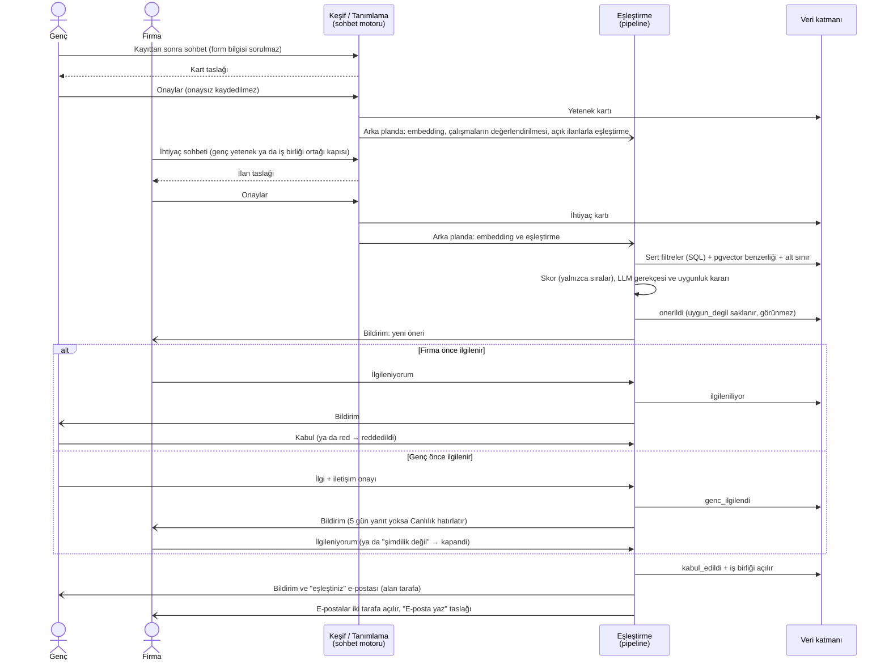
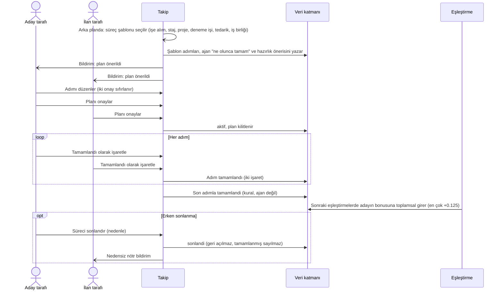
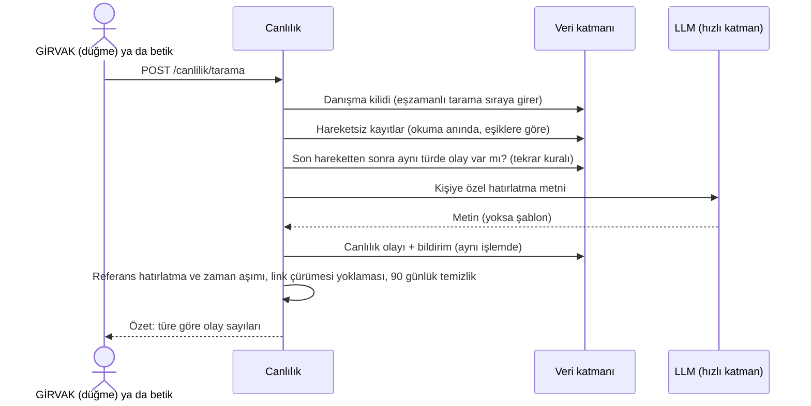

# Sequence Diyagramları

Uçtan uca dört akış. Arka plan işleri (`BackgroundTasks`) yanıt döndükten sonra çalışır;
diyagramlarda "arka planda" diye işaretli.

## Akış 1 — Kart, ilan ve eşleşme (iki kapı)

Genç ve firma aynı anda platformda olmak zorunda değil: eşleştirme hangisi önce gelirse gelsin
kart ya da ilan onaylanınca o kayıt için çalışır.



Kural tek fonksiyonda (`app/agents/eslesme_durumu.py`); geçersiz geçiş 409, aynı geçişin tekrarı
200 ve yan etkisiz. Ayrıntı: `kimlik-ve-dongu.md` § 5. Firma–firma'da aday tarafında bir firma
vardır; akış aynıdır.

## Akış 2 — Doğrulama (kanıt, referans ve zaman aşımı dalı)

Zaman aşımı bir hata değil, tasarlanmış bir dal: kişiyi cezalandırmayan nötr bir durum.

```mermaid
sequenceDiagram
  actor G as Genç
  participant D as Doğrulama
  participant DB as Veri katmanı
  actor R as Referans kişi

  G->>D: Kanıt ekler (link, dosya ya da görsel)
  D->>D: Okuma zinciri: platform → genel → yedek okuyucu; seviye (A-D)
  D->>D: Model alıntıyla gerçek çıkarır, kural puanlar
  D->>DB: Güven göstergesi (okunamayan başlık "—", 0 değil)

  G->>D: Referans ister (gencin kendi adresi 422)
  D->>R: Tek kullanımlık bağlantı e-postayla (genç bağlantıyı görmez)

  opt Adres yanlışsa
    G->>D: Geri çeker (geri_cekildi)
  end
  opt 3. gün, yanıt yoksa (Canlılık taraması)
    D->>R: Tek hatırlatma
  end

  alt 7 gün içinde yanıt
    R->>D: 4 soruluk form (ilişki; çalışma, pay, sonuç doğru mu)
    D->>DB: Koşullu güncelleme (yalnızca bekliyor ise), Referans başlığı
    D-)G: Bildirim; pay / sonuç "evet" ise arka planda yeniden puanlama
  else Zaman aşımı (okuma anında ya da taramada)
    D->>DB: yanit_yok
    D-)G: Nötr bildirim: yeniden ya da başkasından isteyebilir
  end

  opt Genç itiraz ederse
    G->>D: Not ile itiraz (aynı girdi önceki sonucu döner, en çok 3)
    D->>DB: Yeniden değerlendirme ya da GİRVAK kuyruğu
  end
```

Referans yanıt ucu (`/dogrulama/referans-yaniti`) token'lı ve girişsizdir: referans kişiyi üye
olmaya zorlamak yanıt oranını düşürür. Ayrıntı: `dogrulama.md`.

## Akış 3 — Takip (plan, onay, adımlar, tamamlanma)



Ayrıntı: `takip.md`.

## Akış 4 — Canlılık taraması



Tarama idempotenttir: art arda iki kez çalıştırmak ikinci seferde sıfır olay üretir. Ayrıntı:
`canlilik.md`.
