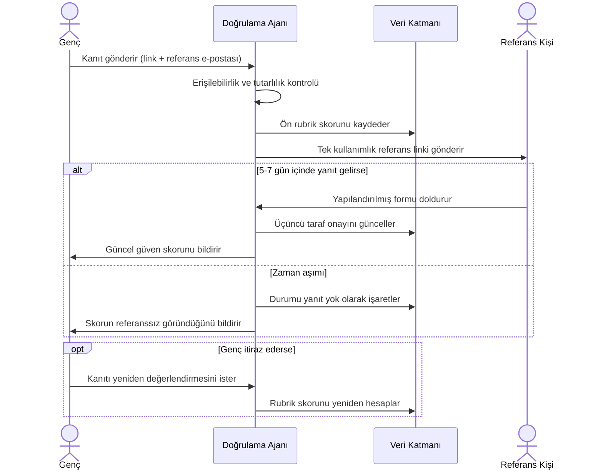

# Sequence Diyagramları

## Akış 1 — Keşif → Tanımlama → Eşleştirme (happy path)

Genç ve kurum akışları birbirinden bağımsız çalışır; aynı anda platformda olmaları gerekmez. Eşleştirme Ajanı ikisini de arka planda periyodik/tetiklemeli okur.

```mermaid
sequenceDiagram
  actor G as Genç
  participant K as Keşif Ajanı
  participant DB as Veri Katmanı
  actor Ku as Kurum
  participant T as Tanımlama Ajanı
  participant E as Eşleştirme Ajanı

  G->>K: Sohbet başlatır
  K->>G: Takip soruları sorar
  G->>K: Cevaplar
  K->>G: Yetenek kartı taslağı gösterir
  G->>K: Onaylar
  K->>DB: Yetenek kartını kaydeder

  Ku->>T: İhtiyaç sohbeti başlatır
  T->>Ku: Netleştirici sorular sorar
  Ku->>T: Cevaplar
  T->>Ku: İhtiyaç kartı taslağı gösterir
  Ku->>T: Onaylar
  T->>DB: İhtiyaç kartını kaydeder

  E->>DB: Kartları okur
  E->>E: Taksonomi eşleme ve skor hesabı
  E->>DB: Eşleşme kaydını yazar
  E->>Ku: Sıralı öneri ve gerekçe gösterir (gencin adı görünür, e-posta yok)
  Ku->>E: İlgileniyorum der
  E->>DB: Eşleşme onerildi → ilgileniliyor
  E->>G: Uygulama içi bildirim ("X kartınla ilgileniyor")
  alt Genç kabul ederse
    G->>E: Kabul eder
    E->>DB: kabul_edildi + ISBIRLIGI açılır
    E->>Ku: Bildirim; iki tarafa e-postalar açılır
  else Genç reddederse
    G->>E: Reddeder
    E->>DB: reddedildi
    E->>Ku: Bildirim (nötr dil)
  end
```

**Mimari sonucu:** Eşleştirme Ajanı senkron bir endpoint değil, ayrı bir arka plan işi (background job / cron) olarak yazılmalı.

**Karşılıklı onay (Faz B):** iş birliği yalnızca gencin kabulüyle açılır; geçiş kuralı tek fonksiyonda (`app/agents/eslesme_durumu.py`). Ayrıntı: `faz-b-kimlik-ve-dongu.md` § 5-6.

## Akış 2 — Doğrulama (referans + zaman aşımı dalı)

Zaman aşımı bir hata değil, tasarlanmış bir dal — kişiyi cezalandırmayan nötr bir durum olarak modellenmeli.



**Mimari sonucu:** Referans yanıt endpoint'i (`/dogrulama/referans-yaniti`) token bazlı ve girişsiz olmalı — referans kişiyi üye olmaya zorlamak yanıt oranını düşürür.
